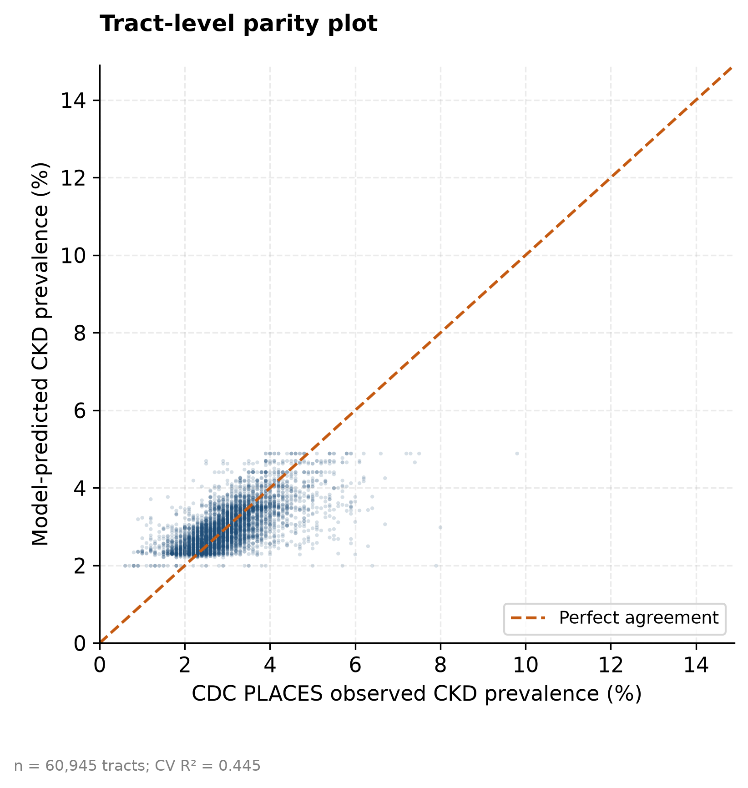
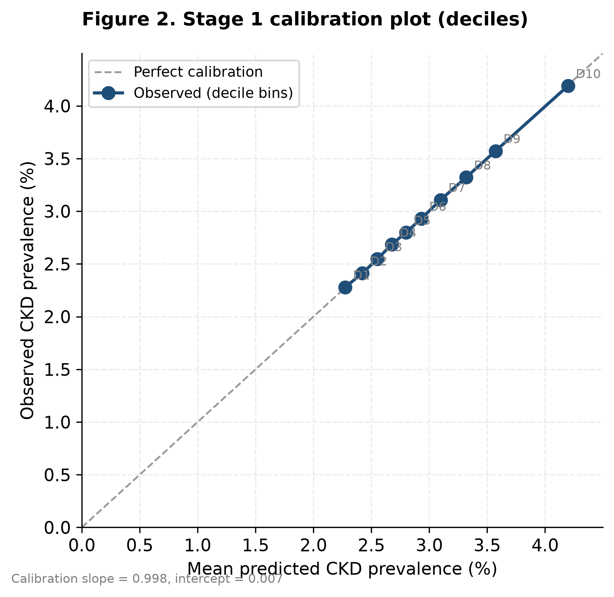
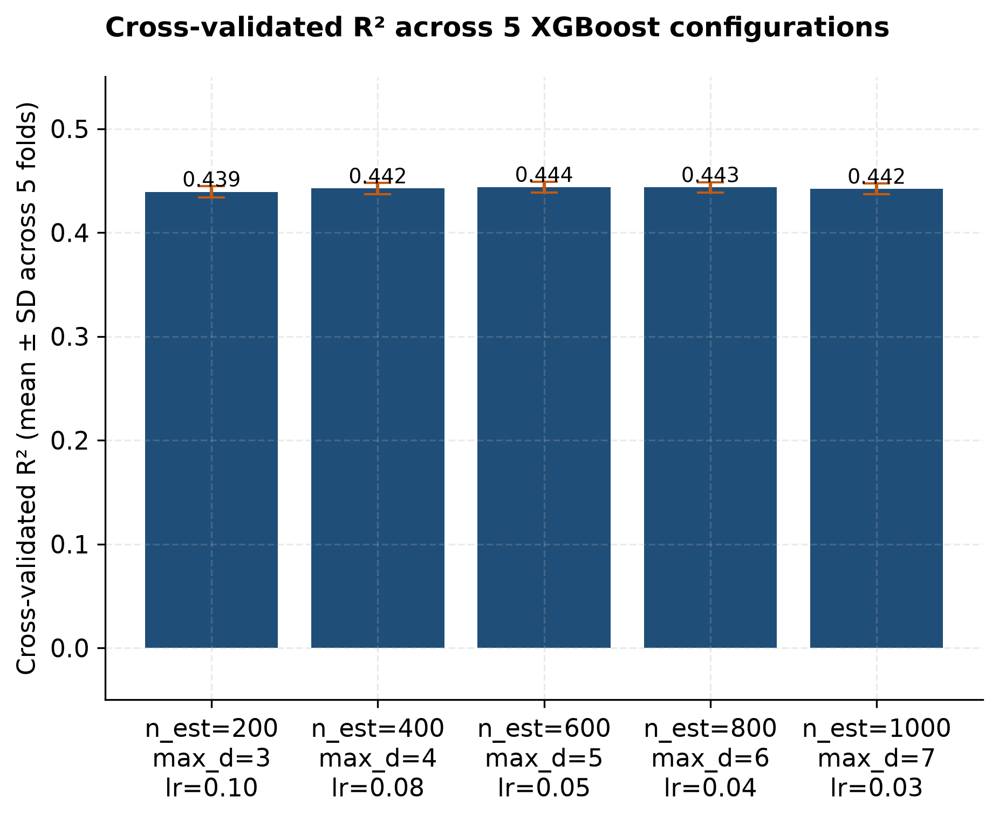
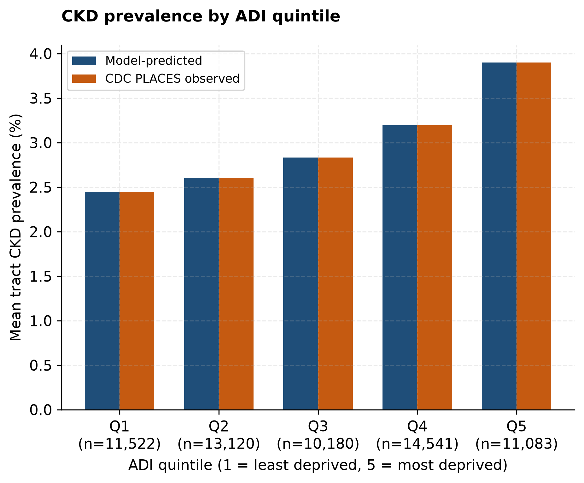
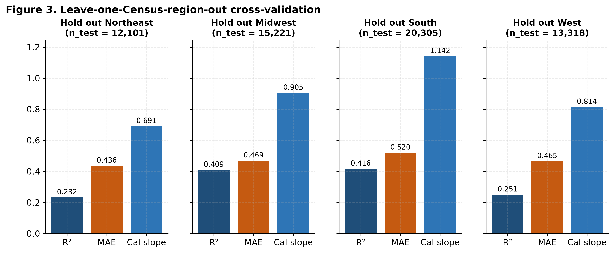
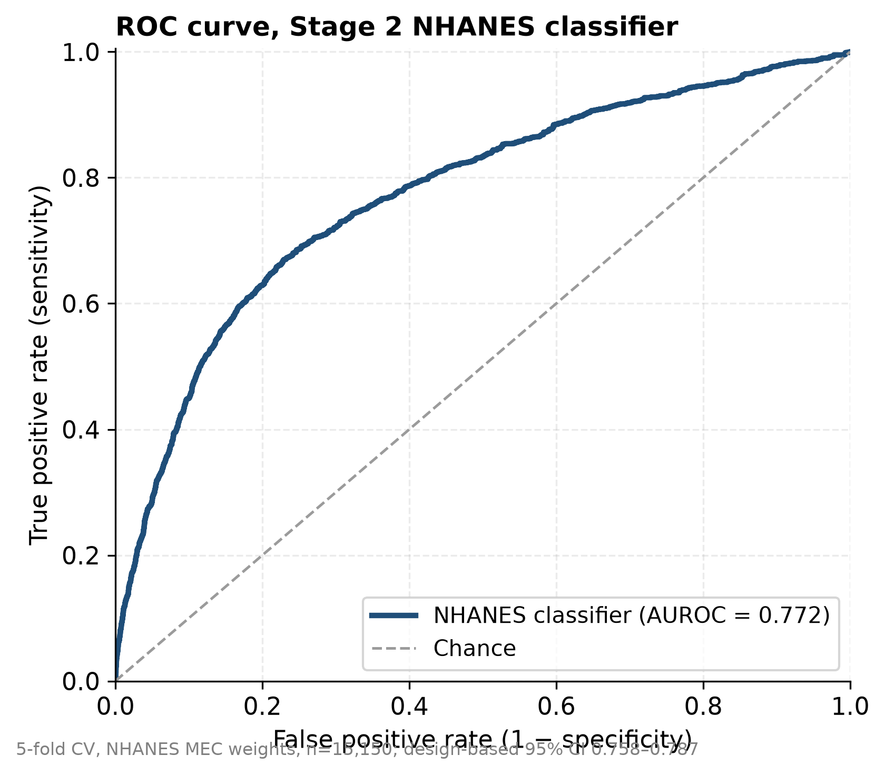
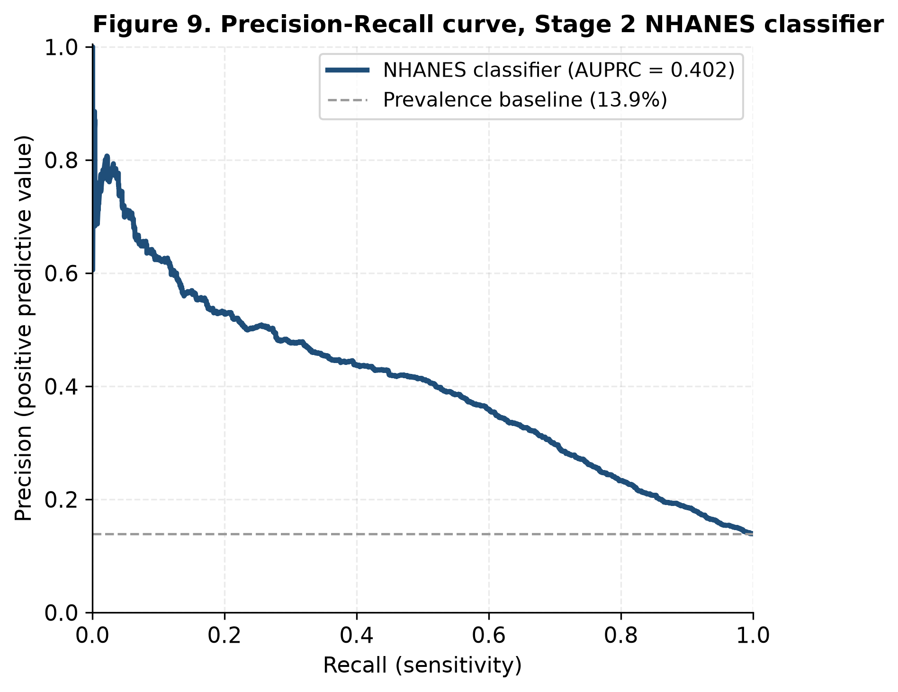
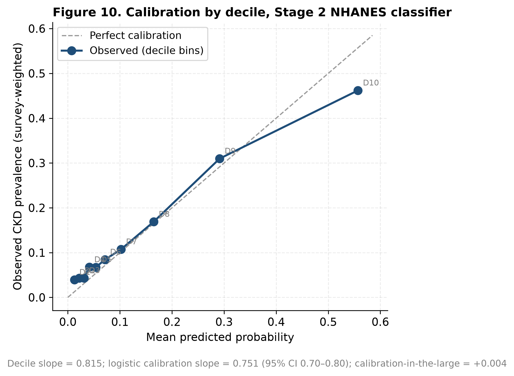
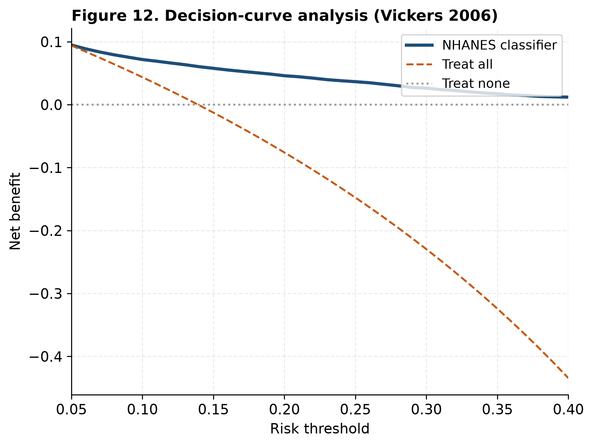
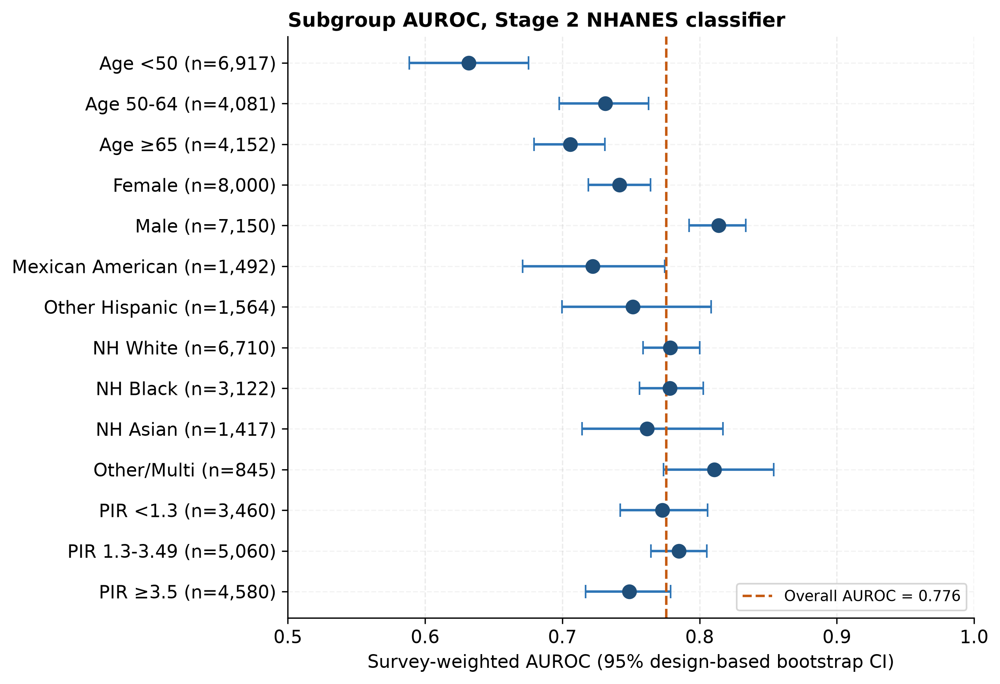

**Neighborhood Deprivation and Undetected Chronic Kidney Disease Burden: Open Small-Area Surveillance and Non-Laboratory Screening Triage Using CDC PLACES and NHANES**

Ajit Sahu^1^, Sanjoy Mukherjee^2^, Kapil Kumar Reddy Poreddy^3^

^1^ DataSafeguard.ai, United States

^2^ Independent Researcher, United States

^3^ [AUTHORS: KKRP affiliation; confirm author order]

**Corresponding author:** Ajit Sahu, asahu@datasafeguard.ai

# Abstract

**Background:** Chronic kidney disease (CKD) affects approximately 14% of US adults, and up to 9 in 10 are unaware of it. The burden is concentrated in deprived neighborhoods, but agencies have few tools to decide where and in whom to offer testing, and the CDC PLACES tract-level CKD estimate was discontinued in 2024.

**Objective:** To determine (1) how much of the neighborhood-level variation in diagnosed CKD prevalence can be explained by area-level social risk, measured with the Area Deprivation Index (ADI), and (2) how accurately and how equitably adults with laboratory markers of CKD can be identified using only information available without laboratory testing.

**Methods:** We conducted a cross-sectional secondary analysis of public data. In 2 separate, unlinked analyses, Stage 1 related tract-mean ADI to the CDC PLACES 2022 tract prevalence of self-reported diagnosed CKD in 60,945 US census tracts using gradient-boosted regression, evaluated with 5-fold and leave-one-Census-region-out cross-validation. Stage 2 used 15,150 adults from NHANES 2017–March 2020 and 2021–August 2023; the outcome was single-visit laboratory markers of CKD (race-free eGFR <60 mL/min/1.73 m² or urine albumin-to-creatinine ratio ≥30 mg/g). Predictors required no laboratory testing. The primary model, logistic regression, was compared with gradient boosting (XGBoost); 95% CIs were survey-design based.

**Results:** Area deprivation explained 44.4% of between-tract variation in diagnosed CKD prevalence (cross-validated R²=0.444, SD 0.006; 0.414 using the national rank alone; mean absolute error 0.45 percentage points), and predictions were well calibrated (slope 0.997). Mean tract prevalence rose from 2.45% in the least-deprived ADI quintile to 3.90% in the most-deprived, a 1.6-fold gradient. Performance was lower when the Northeast (R²=0.232) or West (R²=0.253) was held out. In NHANES, 13.9% of adults had CKD markers, but only 3.0% reported diagnosed kidney disease, and awareness was not lower at lower income. The logistic regression classifier achieved an area under the receiver operating characteristic curve (AUROC) of 0.776 (95% CI 0.762–0.790), similar to XGBoost (difference −0.010, 95% CI −0.027 to 0.004), and was well calibrated (calibration slope 0.99, 95% CI 0.93–1.05; XGBoost 0.73). At 90% specificity, sensitivity was 45.6% (95% CI 42.8%–48.8%). AUROC was 0.72–0.81 across race/ethnicity groups, but at this threshold sensitivity ranged from 28% in other Hispanic to 58% in non-Hispanic Black adults, and was 7% in adults younger than 50 years.

**Conclusions:** Area deprivation reproduces the deprivation gradient in diagnosed CKD and offers an open way to keep prioritizing neighborhoods now that tract-level estimates are discontinued, provided it is recalibrated by region. A published regression score without laboratory inputs identifies adults with CKD markers with moderate accuracy, but a single threshold misses far more cases in some groups than others, so thresholds and calibration need to be set locally. Neither tool replaces laboratory testing.

**Keywords:** chronic kidney disease; public health surveillance; social determinants of health; area deprivation index; screening; NHANES; CDC PLACES; health equity; prediction model; calibration

# Introduction

Chronic kidney disease (CKD) affects more than 1 in 7 US adults, about 35.5 million people, and as many as 9 in 10 adults with CKD are unaware of their condition {{cdc2023}}. Undetected CKD progresses silently toward kidney failure and markedly raises cardiovascular risk. Kidney failure treated with dialysis costs Medicare roughly USD 89,000 per patient per year {{usrds2023}}. Detection is inexpensive: a serum creatinine test and a urine albumin-to-creatinine ratio. The public health problem is therefore less about diagnostic technology than about deciding *where* and *in whom* to offer testing when resources for outreach and screening are limited.

The burden of CKD is not evenly distributed. Socioeconomic disadvantage is consistently associated with higher CKD prevalence, faster progression, and worse outcomes, both at the individual level and at the neighborhood level {{vart2015}}{{crews2010}}{{nicholas2015}}. In this paper we use *social risk* in the sense proposed by Alderwick and Gottlieb {{alderwick2019}}: adverse social conditions, such as low income, low educational attainment, unemployment, and poor housing quality, that are associated with poor health. Social risk is distinct from *social needs*, which are the priorities identified by individuals themselves. Social risk can be measured for places, such as a neighborhood's deprivation, or for people, such as a household's income relative to the poverty line. Both are directly relevant to how health departments target CKD outreach.

Health departments have relied on the CDC PLACES program for small-area estimates of chronic disease to target such outreach. PLACES produced model-based estimates of CKD prevalence for every US census tract. That measure was discontinued in the 2024 PLACES release {{places_notes}}, so the most recent tract-level CKD estimates reflect 2020 survey data and will not be updated. Agencies that use these estimates to locate high-burden neighborhoods need a transparent replacement built from data that continue to be published. At the individual level, existing CKD screening questionnaires, such as SCORED {{bang2007}} and the Kshirsagar incident-CKD score {{kshirsagar2008}}, were developed on data from 1999–2002 and earlier. They predate the 2021 race-free eGFR equation and the current KDIGO definition of CKD, and they did not report calibration across income or race/ethnicity groups. Machine-learning CKD models are numerous, but their reported performance depends heavily on kidney laboratory inputs such as eGFR and albuminuria, which are unavailable before testing occurs {{sanmarchi2023}}. Established kidney risk equations such as the Kidney Failure Risk Equation also require eGFR and albuminuria {{tangri2011}}.

This study addressed two public health questions. First, how much of the neighborhood-level variation in CKD prevalence is explained by area-level social risk, and is that relationship stable enough across US regions to support neighborhood prioritization once tract-level surveillance estimates are no longer produced? Second, how accurately can adults with laboratory-defined CKD be identified using only information available without a blood or urine test? Is that accuracy comparable across age, sex, race/ethnicity, and individual-level income groups, and does a more complex machine-learning model add anything over a transparent regression score? We answered both questions using only publicly available data and openly released code, so that health departments can reproduce, audit, and recalibrate the tools for their own populations.

# Methods

## Study Design and Data Sources

This was a cross-sectional secondary analysis of three publicly available data sources, organized in two stages. The two stages are separate analyses that share a design philosophy but are not linked: Stage 1 predictions are not used as inputs, priors, or offsets in Stage 2, and the 2 stages share no records. Linking them would require the census tract of each NHANES participant, which is available only as restricted data through the NCHS Research Data Center. In Stage 1, census tracts were the unit of analysis. Area-level social risk was measured with the University of Wisconsin Neighborhood Atlas Area Deprivation Index (ADI) 2020 {{kind2018}}. The 2020 ADI is a composite of 17 indicators of income, education, employment, and housing quality from the 2016–2020 American Community Survey (ACS) 5-year estimates {{adi_changelog}}, released for 242,335 census block groups as a national percentile rank (1–100) and a within-state decile (1–10). The outcome was the crude prevalence of CKD among adults aged 18 years or older from the CDC PLACES 2022 census tract release (dataset shc3-fzig) {{places2022}}. This measures *self-reported diagnosed* CKD: PLACES derives it from Behavioral Risk Factor Surveillance System (BRFSS) responses to whether a health professional ever said the respondent had kidney disease, using multilevel regression and poststratification {{zhang2014}}; for this measure the 2022 release uses 2020 BRFSS data, with 2015–2019 ACS estimates among the model covariates {{places2022}}. It is therefore a different construct from the laboratory-measured CKD markers used in Stage 2, and it captures only the minority of CKD that has been diagnosed and is known to the respondent. The release covers 72,337 tracts, with prevalence ranging from 0.5% to 14.4% (mean 2.96%).

In Stage 2, individuals were the unit of analysis. We used the National Health and Nutrition Examination Survey (NHANES) 2017–March 2020 pre-pandemic combined release and the August 2021–August 2023 cycle {{nhanes}}. We included adults aged 18 years or older with serum creatinine or urine albumin and creatinine measured at the mobile examination center (MEC). We merged the demographic, body measures, standard biochemistry, urine albumin/creatinine, oscillometric blood pressure, blood pressure and cholesterol, diabetes, medical conditions, and income files. Of 17,846 adults aged 18 years or older in the 2 cycles, 15,150 had serum creatinine or urine albumin and creatinine measured and formed the analytic cohort; all had a positive survey weight. The sample size was fixed by the available NHANES data rather than calculated in advance. With 2,706 participants meeting the outcome definition and 15 regression parameters besides the intercept (10 predictors and 5 indicator terms for race/ethnicity), there were about 180 outcome events per parameter. Because the outcome depends on serum creatinine, a blood analyte, we used the phlebotomy weight for 2021–2023 (WTPH2YR), as NCHS recommends for analyses of blood analytes {{nhanes_2123_guidance}}; the 2017–March 2020 release has no separate phlebotomy weight, so we used its MEC examination weight (WTMECPRP). Following the NHANES weighting tutorial, we combined the cycles in proportion to the years each covers, multiplying the 2017–March 2020 weights by 3.2/5.2 and the 2021–2023 weights by 2/5.2. Variance strata were treated as distinct between cycles.

## Stage 1: Area Deprivation and Tract-Level CKD Prevalence

Block-group ADI ranks were averaged within each census tract (unweighted mean; the ADI file carries no population counts) to give three tract-level features: mean national rank, mean state rank, and mean ADI quintile, with each block group's quintile derived from its national rank (ranks 1–20 as quintile 1 through 81–100 as quintile 5). For quintile summaries, each tract was assigned to the quintile nearest its mean block-group quintile, so the 5 tract groups differ in size. The 3 features are therefore collinear by construction. Tracts were linked to PLACES by tract FIPS code. Block-group ADI values suppressed by the Neighborhood Atlas (group quarters, low population, or questionable data; 6,449 of 242,335 block groups) were treated as missing. Of the 72,337 PLACES tracts, 60,945 (84.3%) linked to an ADI tract, and 24,450 of the 85,395 ADI tracts (28.6%) had no PLACES match. In 499 linked tracts, every block group was suppressed; these tracts were retained in the model, which handles missing values natively, but have no ADI quintile and are omitted from quintile summaries. Most unlinked tracts are likely attributable to the difference in boundary vintage between the two products: the ADI uses 2020 Census geography and the PLACES 2022 tract files use 2010 Census tracts.

We modelled tract CKD prevalence as a function of the three ADI features using gradient-boosted regression trees (XGBoost {{xgboost}}; 600 trees, maximum depth 5, learning rate 0.05, row and column subsampling 0.9). Hyperparameters were fixed in advance rather than tuned. As a robustness check, we refit the model across 5 configurations that varied the number of trees (200–1000), depth (3–7), and learning rate (0.10–0.03) together and, because such a ladder roughly holds effective capacity constant, also varied each of the 3 factors one at a time around the main configuration. We estimated performance with random 5-fold cross-validation, with tracts ordered by FIPS code so that fold assignment does not depend on the order of the downloaded file, and with leave-one-Census-region-out cross-validation. The latter trains on 3 of the 4 Census regions (Northeast, Midwest, South, West) and predicts the fourth, to test whether the deprivation–CKD relationship transfers between regions. We report R², mean absolute error (MAE), the Spearman rank correlation between predicted and observed prevalence, and calibration, summarized as the slope and intercept of observed on predicted prevalence across deciles of out-of-fold predictions and, because binning pulls the slope toward 1, from the tract-level regression of observed on predicted prevalence. We also report mean predicted and observed prevalence by ADI quintile. As sensitivity analyses, we repeated the 5-fold cross-validation with whole states and, separately, whole counties held out together, because neighboring tracts are spatially correlated, and with the national ADI rank as the only feature, because the national and state ranks together partly identify a tract's state.

## Stage 2: Identifying Adults With CKD Without Laboratory Testing

The outcome was single-visit laboratory markers of CKD at the KDIGO 2024 thresholds {{kdigo2024}}: estimated glomerular filtration rate (eGFR) below 60 mL/min/1.73 m², or urine albumin-to-creatinine ratio (UACR) of 30 mg/g or above. For brevity, "CKD" in the Stage 2 results refers to these markers. eGFR was calculated with the 2021 race-free CKD-EPI creatinine equation {{inker2021}}. UACR was calculated as urine albumin (mg/L) × 100 divided by urine creatinine (mg/dL). Because both measurements come from a single examination, the outcome is not a KDIGO diagnosis of CKD: the criterion that abnormalities persist for more than 3 months cannot be applied. This single-measurement definition is the established convention for national CKD prevalence estimates from NHANES, including those of the CDC CKD Surveillance System {{cdc2023}}{{murphy2016}}{{coresh2007}}. It somewhat overestimates persistent CKD, mainly because albuminuria measured once can be transient {{coresh2007}}. Participants were included if they had serum creatinine or both urine albumin and urine creatinine. Because the outcome is positive if either marker is abnormal, a participant missing one component can be classified only on the other, so we report how many participants had only one component and repeat the analysis among those with both.

The predictors were limited to information obtainable without laboratory testing. These were age, sex, race/ethnicity (NHANES RIDRETH3, 6 categories), family income-to-poverty ratio (PIR), body mass index, and systolic and diastolic blood pressure, calculated as the mean of up to 3 oscillometric readings. Self-reported diagnoses of hypertension, diabetes, heart failure, and stroke were also included. Responses of "refused" or "don't know" were treated as missing. The primary model was an L2-penalized logistic regression (C=1.0) with median imputation and standardization fitted within each training fold, one-hot encoding of race/ethnicity, and the survey weights as sample weights, without class reweighting so that predicted probabilities remain on the risk scale. The comparator was an XGBoost classifier (500 trees, maximum depth 4, learning rate 0.05, subsampling 0.9), which handles missing values natively, trained with the same weights. Hyperparameters were fixed in advance. In the previous version of this manuscript XGBoost was the primary model and the logistic regression used balanced class weights, which distort predicted probabilities. Once the logistic regression was fitted without class reweighting it discriminated as well as XGBoost and was better calibrated, so we made it the primary model in this revision; XGBoost results are reported in full alongside it.

Comparing the two models answers whether a transparent regression score, which a health department can publish and apply by hand, performs as well as the machine-learning model. So that the comparison reflects model class rather than missing-data strategy, XGBoost was also fitted with the same median imputation inside each training fold, and XGBoost with native missing-value handling is reported alongside. We report the logistic regression coefficients in original units, with the imputation values, so that the score can be applied directly (Multimedia Appendix 1). To show how much the clinical predictors add beyond basic demographics, we fitted the same logistic regression with 2 reduced predictor sets: age and sex only, and age, sex, race/ethnicity, PIR, and body mass index.

Both models were evaluated on out-of-fold predictions from the same stratified 5-fold cross-validation (random seed 42). All performance measures were survey-weighted. We assessed discrimination with the AUROC and the area under the precision–recall curve (AUPRC). Overall accuracy was summarized with the Brier score. Calibration was assessed with the logistic calibration slope and intercept (the regression of the outcome on the logit of predicted risk, with the intercept estimated with the logit as an offset) and calibration-in-the-large, following Van Calster et al {{vancalster2019}}. We also fitted a flexible calibration curve (weighted logistic regression of the outcome on a cubic spline of the logit of predicted risk) with pointwise 95% CIs, summarized it with the integrated calibration index (ICI), E50, and E90 {{austin2019}}, and report the Brier skill score relative to a prevalence-only model. We report clinical usefulness as sensitivity, specificity, and predictive values at prespecified specificity targets (95%, 90%, 80%, 70%, and 60%), and as net benefit from decision-curve analysis {{vickers2006}}. Reporting of the Stage 2 model follows the TRIPOD+AI statement {{collins2024}} (Multimedia Appendix 3).

Equity of performance was assessed within age groups (<50, 50–64, ≥65 years), sex, the 6 race/ethnicity categories, and 3 categories of individual-level social risk. Because AUROC is insensitive to calibration and to who is missed at a fixed threshold, we report for each subgroup not only AUROC but also sensitivity, specificity, positive and negative predictive values, and the proportion flagged at the 90%-specificity threshold, together with subgroup calibration-in-the-large and calibration slope. These categories were PIR below 1.3 (approximately the eligibility threshold for the Supplemental Nutrition Assistance Program), 1.3 to 3.49, and 3.5 or above. Because the CKD outcome is race-free but race/ethnicity is a predictor, we also refit the model without race/ethnicity to quantify how much the model depends on it.

All 95% CIs were design-based. We used the Rao–Wu rescaled bootstrap {{raowu1988}} with 1,000 replicates: within each NHANES masked variance stratum (SDMVSTRA), primary sampling units (SDMVPSU) were resampled with replacement, and the survey weights were rescaled accordingly. This accounts for the stratified, clustered NHANES design, which simple resampling of individuals ignores. For single-model metrics, out-of-fold predictions were held fixed across replicates, so the intervals reflect sampling uncertainty in the evaluation sample. For the comparison between models, the full 5-fold cross-validation of every model was re-run inside each replicate, using the replicate weights, so that the interval for the difference also reflects refitting; differences are reported with 95% CIs, without P values.

In the primary model, missing predictor values were imputed with the training-fold median. As a sensitivity analysis, we used multiple imputation by chained equations (m=5, with posterior sampling) fitted within each training fold, and refit the model on each imputed data set. The race-free and complete-case sensitivity analyses also refit the primary model. Because 4 predictors are self-reported diagnoses, we estimated how often a diagnosis is likely missing from self-report. Among adults reporting no hypertension diagnosis, we calculated the survey-weighted proportion whose measured blood pressure was 140/90 mm Hg or higher, overall and by PIR group. To relate the Stage 1 construct to the Stage 2 outcome, we used the NHANES kidney conditions questionnaire item most comparable to the BRFSS question behind PLACES ("Ever told you had weak or failing kidneys?") to estimate self-reported kidney disease prevalence and, among adults with CKD markers, awareness, overall and by PIR group.

## Reproducibility

All analysis code is available in the public project repository, and the version that produced the results reported here is archived with a persistent identifier {{github}}. The pipeline runs from raw public downloads to every figure and table: src/fetch_nhanes.py and src/fetch_places.py download the source files, src/train_ecological_model.py fits Stage 1, src/train_nhanes_model.py fits Stage 2, src/stage2_supplementary.py produces the confidence intervals and the calibration, subgroup, imputation, operating-point, race-free, and awareness analyses, src/stage2_model_comparison.py produces the model comparison, and src/generate_ecological_figures.py and src/generate_stage2_figures.py produce the figures and tables. The Stage 1 script stops with an error if the Neighborhood Atlas file is absent rather than substituting other data; its output file records the data source (adi_source: real_neighborhood_atlas). The metric files produced by the pipeline are provided in Multimedia Appendix 2. Analyses used Python 3.11, scikit-learn 1.8, XGBoost 3.2, and pandas 3.0 with a fixed random seed of 42. All results reported in this article were generated on [AUTHORS: final regeneration date], from the archived version 6.0.1 of the code.

## Ethical Considerations

This study was a secondary analysis of publicly available, deidentified data, and the authors had no interaction with participants. NHANES data collection was approved by the NCHS Research Ethics Review Board (Protocol #2011-17 for data collected before October 26, 2017; Protocol #2018-01 for data collected from October 26, 2017 through March 2020; and Protocol #2021-05, listed for NHANES 2021–2022, for the August 2021–August 2023 cycle) {{nchs_erb}}. NHANES participants provided written informed consent under these protocols, and participants received remuneration from NCHS for the examination; no compensation was provided in this secondary analysis. CDC PLACES and the Neighborhood Atlas ADI are aggregate, area-level data containing no individual-level information. Because the analysis used only publicly released, deidentified data and the investigators could not identify any individual, it does not constitute human subjects research under the US Common Rule (45 CFR 46.102(e)(1)) {{cfr46}}. Institutional review board approval and additional informed consent were therefore not required, and none was sought. NHANES public-use files are deidentified by NCHS through its disclosure review process. We did not attempt to link NHANES records to any other data source or to geographic identifiers. The Neighborhood Atlas ADI file was obtained under its no-cost data use agreement and is not redistributed with this article.

# Results

## Stage 1: Area Deprivation Explains Much of the Neighborhood CKD Burden

Across 60,945 linked census tracts, the three ADI features explained 44.4% of between-tract variation in CKD prevalence (cross-validated R²=0.444, SD 0.006 across folds). The mean absolute error was 0.45 percentage points (Figure 1; Table 1). Out-of-fold predictions were well calibrated, with a decile calibration slope of 0.997 and intercept of +0.008 percentage points (Figure 2). The Spearman rank correlation between predicted and observed tract prevalence was 0.675. The 2 measures are not contradictory: R² reflects squared prediction error relative to the total variance and is lowered when predictions are compressed toward the mean, whereas rank correlation is not affected by that compression (for reference, the square root of the cross-validated R² is 0.666). Rank correlation is the more directly relevant measure when the model is used to order tracts for prioritization. Across 5 configurations that varied the number of trees, tree depth, and learning rate together, R² ranged from 0.439 to 0.444 (Figure 3). Because that ladder raises tree count and depth while lowering the learning rate, it roughly holds effective capacity constant, so we also varied each factor separately around the main configuration; R² ranged from 0.440 to 0.444 (Multimedia Appendix 1, Table S1). Within the range examined, the result is therefore not sensitive to these choices. The national ADI rank alone gave a cross-validated R² of 0.414 (SD 0.006), so most of the explained variation comes from national deprivation; the remainder partly reflects state membership, which the state and national ranks together reveal. Because neighboring tracts are correlated, we also held out whole states and whole counties in cross-validation; R² was 0.416 (SD 0.108 across folds) and 0.433 (SD 0.035), so spatial dependence inflated the random cross-validation estimate only modestly. The tract-level regression of observed on out-of-fold predicted prevalence had a slope of 0.995 and an intercept of 0.014 percentage points, consistent with the decile-based calibration.

Observed PLACES prevalence rose monotonically with deprivation, from a tract mean of 2.447% in the least-deprived ADI quintile to 3.901% in the most-deprived, a 1.6-fold difference (Table 2; Figure 4). Mean out-of-fold predicted prevalence was within 0.001 percentage points of observed prevalence in every quintile. This close agreement is expected despite an R² of 0.444: the quintile is itself a model input, so out-of-fold predictions reproduce each quintile's mean, which is the between-quintile component of variation, whereas R² is driven mainly by the much larger variation between tracts within the same quintile, which deprivation does not explain. The model also compresses the extremes of individual tracts (predicted values span roughly 2%–5%, against observed values of 0.5%–14.4%; Figure 1). The 3 Stage 1 features are collinear by construction: the quintile is a coarsening of the national rank, and the state rank re-ranks the same index within each state. Split-based feature importance is not interpretable under this collinearity, so we do not rank the features.

The relationship transferred unevenly between regions (Figure 5). A model trained on the other 3 regions explained 41.7% of variation in the South and 40.9% in the Midwest, but only 25.3% in the West and 23.2% in the Northeast. Calibration slopes in the held-out regions were 0.69 (Northeast), 0.82 (West), 0.91 (Midwest), and 1.15 (South). A slope below 1 means that the deprivation gradient in that region is flatter than the national model assumes. The model therefore overestimates prevalence in that region's most-deprived tracts and underestimates it in the least-deprived. A slope above 1, as in the South, means the gradient is steeper than the national model assumes.

**Table 1. Performance of the Stage 1 model for tract prevalence of diagnosed CKD (CDC PLACES 2022).**

| Validation | Tracts, n | R² | MAE, percentage points | Calibration slope | Calibration intercept, percentage points |
|---|---|---|---|---|---|
| Random 5-fold cross-validation | 60,945 | 0.444 (SD 0.006) | 0.452 | 0.997 | +0.008 |
| Held-out region: Northeast | 12,101 | 0.232 | 0.436 | 0.693 | +0.881 |
| Held-out region: Midwest | 15,221 | 0.409 | 0.470 | 0.906 | +0.091 |
| Held-out region: South | 20,305 | 0.417 | 0.520 | 1.145 | −0.248 |
| Held-out region: West | 13,318 | 0.253 | 0.464 | 0.817 | +0.480 |

*Out-of-fold predictions. Spearman rank correlation between predicted and observed tract prevalence (random 5-fold): 0.675. In leave-one-region-out validation the model is trained on the other 3 Census regions. Calibration slope and intercept are from the regression of observed on predicted prevalence across deciles of predicted prevalence.*

**Table 2. Observed (CDC PLACES) and out-of-fold predicted tract prevalence of diagnosed CKD by ADI quintile.**

| ADI quintile | Tracts, n | Observed, mean % | Predicted, mean % |
|---|---|---|---|
| 1 (least deprived) | 11,522 | 2.447 | 2.447 |
| 2 | 13,120 | 2.603 | 2.602 |
| 3 | 10,180 | 2.833 | 2.833 |
| 4 | 14,541 | 3.195 | 3.195 |
| 5 (most deprived) | 11,083 | 3.901 | 3.901 |

*499 linked tracts in which every block group was ADI-suppressed have no quintile and are not shown.*

{width="6.0in"}

*Figure 1. Out-of-fold predicted versus CDC PLACES–observed CKD prevalence for 60,945 census tracts. Each point is one tract; the dashed line indicates perfect agreement. Cross-validated R²=0.444.*

{width="6.0in"}

*Figure 2. Calibration of the Stage 1 model: mean out-of-fold predicted versus observed CKD prevalence by decile of predicted prevalence (slope 0.997, intercept +0.008 percentage points).*

{width="6.0in"}

*Figure 3. Cross-validated R² (mean and SD across 5 folds) across 5 XGBoost configurations that vary the number of trees, depth, and learning rate together. One-factor-at-a-time results are in Multimedia Appendix 1, Table S1.*

{width="6.0in"}

*Figure 4. Mean out-of-fold predicted and CDC PLACES–observed tract prevalence of diagnosed CKD by ADI quintile (1=least deprived, 5=most deprived); values to 3 decimals with tract counts are in Table 2.*

{width="6.0in"}

*Figure 5. Leave-one-Census-region-out validation. Panels show, for each held-out region when the model is trained on the other 3 regions, the R² (left), the MAE in percentage points (center), and the decile-binned calibration slope (right; dashed line marks a slope of 1).*

## Stage 2: Identifying Adults With CKD Without Laboratory Testing

Of 15,150 adults (representing 248.8 million US adults), 2,706 met the CKD definition, a survey-weighted prevalence of 13.9% (Table 3). This matches CDC's published national estimate {{cdc2023}}. Adults with CKD were older (mean age 60.1 vs 45.6 years) and more often reported hypertension (60.1% vs 26.8%), diabetes (33.1% vs 8.2%), or heart failure (9.7% vs 1.6%). They also had a lower mean income-to-poverty ratio (2.72 vs 3.13). Prevalence followed an individual-level social risk gradient: 16.3% among adults with PIR below 1.3, 16.8% at PIR 1.3–3.49, and 10.4% at PIR 3.5 or above. Missing data were most common for PIR (13.5%) and blood pressure (7.3%) and were below 5% for all other predictors (Multimedia Appendix 1, Table S2). Both outcome components were available for 13,666 participants; 249 had serum creatinine only and 1,235 had urine measures only. Prevalence was 13.8% among those with both components. Restricted to these participants, the AUROC of the out-of-fold predictions was 0.778 (95% CI 0.764–0.794), and 0.777 when the model was refit on them alone.

Diagnosed and measured CKD differed greatly. Among the 14,443 participants who answered the kidney question, only 3.0% (95% CI 2.6%–3.4%) of adults reported ever being told they had weak or failing kidneys, close to the 2.96% mean of the PLACES tract estimates, against 14.1% with CKD markers among the same respondents. Among adults with CKD markers, 13.3% (95% CI 11.7%–14.8%) were aware of it. Awareness was not lower at lower income: 16.0% (12.5%–19.9%) at PIR below 1.3, 12.9% (10.1%–15.3%) at 1.3–3.49, and 13.2% (9.7%–16.7%) at 3.5 or above. As a result, the income gradient in self-reported kidney disease (4.2% vs 2.2%, ratio 1.91) was steeper than the gradient in CKD markers (16.7% vs 10.5%, ratio 1.59; these prevalences differ slightly from those above because they are restricted to respondents who answered the kidney question).

**Table 3. Characteristics of the NHANES 2017–2023 analytic sample (n=15,150), survey-weighted, by CKD status.**

| Characteristic | Overall | No CKD | CKD |
|---|---|---|---|
| Participants, n (unweighted) | 15,150 | 12,444 | 2,706 |
| Weighted population, millions | 248.78 | 214.21 | 34.57 |
| Age, years, mean (SD) | 47.6 (17.9) | 45.6 (17.1) | 60.1 (17.6) |
| Female, % | 51.6 | 50.9 | 55.8 |
| Non-Hispanic White, % | 61.4 | 61.5 | 60.6 |
| Non-Hispanic Black, % | 11.2 | 10.5 | 15.3 |
| Hispanic, % | 16.6 | 17.1 | 13.2 |
| Income-to-poverty ratio, mean (SD) | 3.07 (1.64) | 3.13 (1.65) | 2.72 (1.58) |
| Body mass index, kg/m², mean (SD) | 29.7 (7.3) | 29.5 (7.3) | 30.7 (7.6) |
| Systolic blood pressure, mm Hg, mean (SD) | 121.2 (17.2) | 119.9 (15.8) | 129.5 (22.5) |
| Diastolic blood pressure, mm Hg, mean (SD) | 74.0 (10.9) | 73.9 (10.5) | 74.5 (13.5) |
| Self-reported hypertension, % | 31.4 | 26.8 | 60.1 |
| Self-reported diabetes, % | 11.6 | 8.2 | 33.1 |
| Self-reported heart failure, % | 2.7 | 1.6 | 9.7 |
| Self-reported stroke, % | 3.6 | 2.7 | 8.9 |

The logistic regression classifier discriminated adults with and without CKD with an AUROC of 0.776 (95% CI 0.762–0.790) (Figure 6; Table 4). The AUPRC was 0.414 (95% CI 0.388–0.439), against a prevalence baseline of 0.139 (Figure 7), and the Brier score was 0.100 (95% CI 0.095–0.106). The XGBoost comparator achieved an AUROC of 0.766 (95% CI 0.751–0.780). With both models given the same median imputation, XGBoost achieved 0.766, a difference from logistic regression of −0.010 (95% CI −0.027 to 0.004; cross-validation re-run within each of 1,000 design-based bootstrap replicates). XGBoost with native missing-value handling differed from logistic regression by −0.010 (−0.028 to 0.003) and from XGBoost with median imputation by −0.001 (−0.007 to 0.005), so the missing-data strategy made little difference. Because each replicate refits the models on a resampled set of primary sampling units, these intervals also reflect variation in the training data; the point estimates give no indication that gradient boosting improves on logistic regression. Much of the discrimination came from demographics. Logistic regression with age and sex alone reached an AUROC of 0.726 (95% CI 0.714–0.738), and adding race/ethnicity, PIR, and body mass index raised it to 0.746 (0.733–0.760). Measured blood pressure and the self-reported conditions added a further 0.030 (95% CI 0.024–0.036), and the full model improved on age and sex alone by 0.050 (0.042–0.059). The coefficients of the full model, in original units and with the values used to impute missing predictors, are given in Multimedia Appendix 1, Table S7; the largest odds ratios were for self-reported diabetes (2.71), heart failure (2.36), and hypertension (1.75).

The logistic regression was well calibrated. Overall predicted risk matched observed prevalence (calibration-in-the-large −0.000, 95% CI −0.006 to 0.006; logistic calibration intercept −0.001, −0.062 to 0.061), and the logistic calibration slope was 0.99 (95% CI 0.93–1.05). The flexible calibration curve lay close to the diagonal across the range of predicted risk, apart from slight under-prediction below a predicted risk of about 0.05, and including near the deployed threshold of 0.264: in the highest-risk decile the mean predicted probability was 0.48 against an observed prevalence of 0.48 (Figure 8; decile sizes in Multimedia Appendix 1, Table S3). The ICI was 0.006 (95% CI 0.004–0.013), with E50 0.006 and E90 0.011. The Brier score of 0.100 corresponds to a Brier skill score of 0.164 (95% CI 0.147–0.181) relative to the prevalence-only model (Brier 0.120). Mean predicted risk closely tracked observed prevalence within each income group (16.9% vs 16.3% for PIR <1.3; 10.5% vs 10.4% for PIR ≥3.5). The XGBoost comparator, by contrast, made predictions that were too extreme (logistic calibration slope 0.73, 95% CI 0.68–0.79; ICI 0.025, E90 0.045).

**Table 4. Performance of the Stage 2 non-laboratory classifiers (out-of-fold, survey-weighted; 95% CIs from a design-based bootstrap with 1,000 replicates; model comparisons re-run the cross-validation within each replicate).**

| Measure | Logistic regression (primary), estimate (95% CI) | XGBoost (comparator), estimate (95% CI) |
|---|---|---|
| AUROC | 0.776 (0.762–0.790) | 0.766 (0.751–0.780) |
| AUROC, range across 5 folds | 0.763–0.797 | 0.748–0.793 |
| AUPRC (prevalence baseline 0.139) | 0.414 (0.388–0.439) | 0.397 (0.371–0.426) |
| Brier score | 0.100 (0.095–0.106) | 0.103 (0.097–0.109) |
| Brier skill score vs prevalence-only model | 0.164 (0.147–0.181) | 0.143 (0.120–0.166) |
| Logistic calibration slope | 0.988 (0.932–1.049) | 0.734 (0.684–0.788) |
| Logistic calibration intercept | −0.001 (−0.062 to 0.061) | +0.047 (−0.015 to 0.113) |
| Calibration-in-the-large | −0.000 (−0.006 to 0.006) | +0.004 (−0.001 to 0.010) |
| Integrated calibration index (ICI) | 0.006 (0.004–0.013) | 0.025 (0.019–0.030) |
| E50 | 0.006 (0.002–0.011) | 0.018 (0.012–0.025) |
| E90 | 0.011 (0.006–0.027) | 0.045 (0.025–0.055) |
| Sensitivity at 90% specificity, % | 45.6 (42.8–48.8) | 45.3 (42.2–48.6) |
| AUROC with the same median imputation | 0.776 | 0.766 |
| Difference in AUROC, XGBoost minus logistic regression, same imputation (refit bootstrap) | — | −0.010 (−0.027 to 0.004) |
| Difference in AUROC, XGBoost with native missing values minus logistic regression (refit bootstrap) | — | −0.010 (−0.028 to 0.003) |
| AUROC, logistic regression with age and sex only | 0.726 (0.714–0.738) | — |
| AUROC, logistic regression with age, sex, race/ethnicity, PIR, and body mass index | 0.746 (0.733–0.760) | — |

At a threshold chosen for 90% specificity (predicted risk ≥0.264), the classifier flagged 14.9% of adults. It identified 45.6% of adults with CKD, with a positive predictive value of 42.4% and a negative predictive value of 91.1% (Table 5). Among adults flagged for testing, 42% would therefore have CKD, about 3 times the population prevalence. Lowering the threshold traded specificity for sensitivity. At 70% specificity, for example, sensitivity was 73.7% and 36.1% of adults were flagged (Multimedia Appendix 1, Table S4). The decision curve showed higher net benefit for the model than for testing everyone or no one across risk thresholds of 0.05 to 0.40 (Figure 9). The margin over testing everyone was negligible at a threshold of 0.05.

**Table 5. Classification at the 90%-specificity threshold (predicted risk ≥0.264), survey-weighted to the US adult population (millions).**

| | Classified as not at risk | Classified as at risk |
|---|---|---|
| No CKD | 192.80 | 21.41 |
| CKD | 18.79 | 15.78 |

*Sensitivity 45.6%, specificity 90.0%, positive predictive value 42.4%, negative predictive value 91.1%.*

Discrimination varied more by age and sex than by race/ethnicity or income (Figure 10). AUROC was 0.63 (95% CI 0.59–0.68) in adults younger than 50 years, 0.73 (0.70–0.76) at 50–64 years, and 0.71 (0.68–0.73) at 65 years or older. All three are lower than the overall AUROC because age, the strongest single predictor, varies little within each band. AUROC was 0.81 (0.79–0.83) in men and 0.74 (0.72–0.76) in women, a difference of 0.07 with non-overlapping CIs. Across race/ethnicity groups AUROC ranged from 0.72 (0.67–0.77) among Mexican American adults to 0.81 (0.77–0.85) among adults of other or multiple races, the smallest group (n=845), with overlapping CIs. Across income groups it ranged from 0.75 (0.72–0.78) at PIR 3.5 or above to 0.78 (0.76–0.81) at PIR 1.3–3.49. Removing race/ethnicity as a predictor changed overall AUROC by 0.001 (95% CI −0.001 to 0.003), to 0.775, and by no more than 0.005 within any race/ethnicity group (Multimedia Appendix 1, Table S5). Multiple imputation of missing predictors changed AUROC by −0.001 (mean 0.775 across 5 imputations).

Similar AUROC did not mean similar performance at the deployed threshold (Multimedia Appendix 1, Table S6). Calibration-in-the-large was close to zero within each sex, race/ethnicity, and income group (−0.006 to +0.006), so the model did not systematically over- or under-predict these groups' overall prevalence. Across age groups it ranged from −0.031 at 50–64 years (mean predicted 16.8% vs observed 13.7%) to +0.025 at 65 years or older (30.3% vs 32.9%), and calibration slopes across all subgroups ranged from 0.84 to 1.16. At the 90%-specificity threshold, however, sensitivity differed widely. It was 7.4% (95% CI 5.5%–9.4%) in adults younger than 50 years, 39.6% at 50–64 years, and 68.3% at 65 years or older, where specificity fell to 61.5% and 48.3% of adults were flagged. Sensitivity was 45.9% (42.2%–49.9%) in women and 45.3% (41.1%–49.5%) in men. Among race/ethnicity groups it was lowest in other Hispanic (28.4%, 21.4%–35.3%) and Mexican American adults (31.7%, 24.6%–39.7%), compared with 45.7% in non-Hispanic White and 45.6% in non-Hispanic Asian adults and 57.6% (53.1%–62.5%) in non-Hispanic Black adults. By income it was 53.3% at PIR below 1.3 and 28.1% at PIR 3.5 or above. These differences largely follow differences in the distribution of risk factors, because the threshold is applied to a single predicted risk scale, but they mean that a uniform threshold would leave a larger share of CKD undetected among younger and Hispanic adults. Positive predictive value varied less, from 30% in other Hispanic adults to 46% in adults aged 65 years or older.

{width="6.0in"}

*Figure 6. Receiver operating characteristic curve of the Stage 2 logistic regression classifier (out-of-fold, survey-weighted). AUROC 0.776 (95% CI 0.762–0.790).*

{width="6.0in"}

*Figure 7. Precision–recall curve of the Stage 2 classifier. The dashed line marks the survey-weighted CKD prevalence (13.9%).*

{width="6.0in"}

*Figure 8. Calibration of the Stage 2 classifier: flexible calibration curve (spline-logistic) with 95% design-based pointwise CI and weighted means for each of 10 deciles of predicted risk. Logistic calibration slope 0.99 (95% CI 0.93–1.05), intercept −0.001; ICI 0.006.*

{width="6.0in"}

*Figure 9. Decision-curve analysis of the Stage 2 classifier compared with testing all adults and testing none.*

{width="6.0in"}

*Figure 10. Survey-weighted AUROC by age group, sex, race/ethnicity, and income-to-poverty ratio (PIR), with 95% design-based bootstrap CIs. The dashed line marks the overall AUROC.*

# Discussion

## Principal Findings

Using only public data, we found that area-level social risk, measured by the ADI, explains about 44% of the variation in diagnosed CKD prevalence between US census tracts (41% from the national deprivation rank alone). Prevalence is 1.6 times higher in the most- than in the least-deprived quintile of tracts. The relationship is strongest in the South and Midwest and weaker in the Northeast and West. At the individual level, information available without a laboratory test, such as age, blood pressure, and self-reported conditions, identified adults with laboratory markers of CKD with moderate accuracy (AUROC 0.78). Discrimination was similar across race/ethnicity and income groups but lower in younger adults and in women, and at a fixed threshold the proportion of cases detected differed substantially between groups. A transparent logistic regression, whose coefficients we publish, discriminated as well as gradient boosting and was better calibrated.

## Comparison With Prior Work

Our findings are consistent with prior evidence, which supports their validity, but they answer a different question. The 1.6-fold deprivation gradient in tract CKD prevalence lies within the 1.5- to 2.0-fold socioeconomic gradients reported in earlier individual-level and meta-analytic studies {{vart2015}}{{crews2010}}{{nicholas2015}}, although at the lower end of that range. Model shrinkage does not explain the position, because predicted and observed quintile means coincide. More plausible contributors are the smoothing inherent in PLACES small-area estimation, which pulls tract estimates toward values expected from their demographic composition {{zhang2014}}; the averaging of individual risk within tracts that contain residents of differing socioeconomic position; and the fact that PLACES measures diagnosed rather than total CKD. Under-ascertainment in self-report is large: in NHANES only about 1 in 8 adults with CKD markers (13.3%) reported diagnosed kidney disease. If awareness were lowest where deprivation is highest, the PLACES gradient would understate the true gradient. In NHANES, however, awareness was not lower at lower income, and the income gradient in self-reported kidney disease (ratio 1.91) was steeper than the gradient in CKD markers (1.59). Individual income is not area deprivation, and self-reported kidney disease may disproportionately capture advanced disease, which is more strongly socially patterned, so these data do not settle the direction of bias for tract-level estimates. They do show that the Stage 1 gradient should be read as a gradient in diagnosed CKD, which may differ in either direction from the gradient in total CKD. What is new is not the existence of the gradient but its use for surveillance: we quantify how much of the national small-area CKD map can be recovered from a deprivation index that continues to be published, and how well that relationship transfers between regions. This matters now because CDC PLACES discontinued its tract-level CKD measure {{places_notes}}. Our Stage 1 model is an ecological, interpretable stand-in for prioritizing neighborhoods rather than a replacement for multilevel small-area estimation {{zhang2014}}{{wakefield2020}}. The 56% of variation it does not explain, and its weaker performance in the Northeast and West, show where deprivation is an insufficient guide and where local data are needed.

For individual screening, the most comparable tools are questionnaire-based scores. SCORED reported an AUROC of 0.88 in its NHANES 1999–2002 development data and 0.71 on external validation {{bang2007}}. However, it targeted only reduced eGFR and used a race-based eGFR equation, and two of its inputs, proteinuria and anemia, require laboratory results. Our classifier predicts the broader set of KDIGO 2024 markers, which includes albuminuria with preserved eGFR and is harder to detect from risk factors alone. It uses the race-free 2021 equation, contemporary NHANES data, and no laboratory inputs, and its accuracy (0.78) falls between SCORED's development and validation estimates. The Kshirsagar score {{kshirsagar2008}} is not directly comparable, because it predicts incident CKD over follow-up rather than CKD present at the time of screening. That logistic regression matched XGBoost agrees with a systematic review that found no average benefit of machine learning over logistic regression for clinical prediction models {{christodoulou2019}}. In practice, a health department can apply the published coefficients directly (Multimedia Appendix 1, Table S7), with no loss of accuracy relative to machine learning, although the score should still be checked against local data. A further contribution beyond earlier scores is the reporting of calibration and performance across income and race/ethnicity groups, with survey-design–based uncertainty.

## Public Health Implications

The two stages are not linked models, but they correspond to two decisions that health departments make. Where to send outreach, mobile screening, or community health workers is a neighborhood-level decision, and Stage 1 ranks tracts by expected CKD burden using an index agencies already use for other programs. Who to offer a creatinine and urine albumin test to, once someone is reached, is an individual-level decision, and Stage 2 provides a triage score usable at intake, in pharmacies, or at community events. At a threshold that flags about 1 in 7 adults, 42% of those flagged would have CKD, roughly 3 times the base rate. However, more than half of all adults with CKD would not be flagged. The score is therefore suited to prioritizing testing when testing capacity is limited, not to ruling CKD out. Where capacity allows, a lower threshold or universal testing of adults with hypertension or diabetes, as KDIGO recommends {{kdigo2024}}, captures more cases. In both stages social risk informs targeting directly: Stage 1 allocates attention to places by deprivation, and Stage 2 includes household income as a predictor. Discrimination and calibration-in-the-large were similar across income groups, but sensitivity at the deployed threshold was lower at higher income.

Equity requires care. The CKD outcome uses the race-free eGFR equation, consistent with the NKF-ASN Task Force recommendation {{delgado2022}}, but race/ethnicity is a predictor in Stage 2. Removing it barely changed accuracy (AUROC 0.776 vs 0.775), so agencies that prefer not to use race in allocation can use the race-free version at little cost. The score was well calibrated in this nationally representative sample (calibration slope 0.99), but it over-predicted risk at 50–64 years and under-predicted it at 65 years or older, and calibration in a local population whose prevalence and risk-factor distribution differ is not guaranteed. Any deployment should therefore check, and if needed recalibrate, the score against local data before predicted probabilities are communicated, even if the ranking of individuals is retained. Equal AUROC across groups is not equal performance. At a single threshold the score detected 28% of CKD among other Hispanic and 32% among Mexican American adults, against 58% among non-Hispanic Black adults, and only 7% among adults younger than 50 years. Agencies deploying the score should examine sensitivity and the proportion flagged in each population they serve and, where detection falls short in a group, lower the threshold or offer testing on other grounds. The score should not be the only route to testing for younger adults with diabetes or hypertension.

## Limitations

Several limitations should be considered when interpreting these results. The most important concerns what Stage 1 measures. Its outcome is the PLACES model-based estimate of self-reported diagnosed CKD, not CKD itself. In NHANES, self-reported kidney disease (3.0%) captured roughly one fifth of CKD defined by laboratory markers (14.1%), so Stage 1 describes the geography of diagnosed CKD, whose mean tract prevalence (2.96%) is far below the 14% that the national burden figures refer to. Because diagnosis depends on testing and access to care, the distribution of diagnosed CKD may differ from that of total CKD in ways that are socially patterned. We found no evidence in NHANES that awareness is lower at lower income, but we could not examine awareness by area deprivation, and the direction and size of any bias in the tract-level gradient remain uncertain. Both products also draw on the ACS (the ADI on 2016–2020 and the PLACES model on 2015–2019 estimates), so the PLACES estimation model shares socioeconomic inputs with the ADI, which could inflate the association between them. Validation against laboratory-based data, such as health system or state registry records, is needed before relying on Stage 1 for the burden of total CKD.

The analysis is also ecological. Tract-level associations cannot be applied to individuals, which is why individual triage is addressed separately in Stage 2. The 2 stages were not linked: public NHANES files contain no tract identifiers, so we could not test whether combining tract-level prioritization with individual triage improves detection. About 16% of PLACES tracts and 29% of ADI tracts could not be linked, most likely because of the change in Census tract boundaries between 2010 and 2020. Using the Census relationship file to reallocate these tracts {{census_crosswalk}} would test whether the excluded tracts differ systematically. Conversely, linking by FIPS code also joined tracts whose code was unchanged between 2010 and 2020 even where their boundaries changed, which adds exposure misclassification that we could not measure. Each tract was weighted equally regardless of its population, and the PLACES outcome is itself a model-based estimate whose uncertainty our analysis does not carry forward. Because neighboring tracts are correlated, random cross-validation can overstate performance; holding out whole states or whole counties reduced R² only modestly (0.42 and 0.43, vs 0.44). We also evaluated only one deprivation index; others, such as the Social Vulnerability Index, may perform differently.

For Stage 2, NHANES is cross-sectional and measures creatinine and albuminuria once. The outcome is therefore a single-visit marker rather than a KDIGO diagnosis of CKD: it includes transient abnormalities, which inflate apparent prevalence and are less predictable from risk factors, so measured discrimination is probably lower than for persistent CKD, and it does not capture progression. Because the outcome is positive if either marker is abnormal, the 1,484 participants with only one component could be classified as negative when their missing component was abnormal. This would bias prevalence downward and add outcome misclassification, but restricting the analysis to participants with both components changed prevalence and AUROC little (13.8% and 0.778). The model detects prevalent CKD and does not predict future kidney failure, which tools such as the Kidney Failure Risk Equation address after diagnosis {{tangri2011}}. The 2017–2020 data were collected before the COVID-19 pandemic interrupted fieldwork. NCHS advises caution when combining the August 2021–August 2023 cycle with earlier cycles, because pooled cross-sectional estimates assume that conditions during the unobserved early-pandemic period resembled those in the surveyed periods {{nhanes_2123_guidance}}. We weighted each cycle by the years it covers and treated the strata of the 2 cycles as distinct, but temporal changes between the periods were not modelled. The CKD-EPI 2021 equation that defines the eGFR component of the outcome includes age and sex, which are also predictors, so part of the discrimination attributable to age is built into the outcome definition. Cross-validation folds were formed from individuals rather than primary sampling units, so participants from the same sampling unit could fall in both training and test folds, which may slightly overstate performance. Subgroup results are descriptive: we made no adjustment for multiple comparisons and did not test differences between groups. The multiple-imputation sensitivity analysis reports the mean AUROC across imputations without pooling CIs by Rubin's rules. Performance was estimated by internal cross-validation in a nationally representative sample. External validation in the populations where a health department would use the tool, such as uninsured adults attending community screening events, has not been done. Four predictors are self-reported diagnoses (hypertension, diabetes, heart failure, and stroke) and are subject to recall and reporting bias. Being aware of a diagnosis also depends on prior contact with health care, so the score may be less accurate among people with poor access to care, the group screening most needs to reach. In our data, 9.6% (95% CI 8.6%–10.6%) of adults who reported no hypertension diagnosis had measured blood pressure of 140/90 mm Hg or higher. This proportion was similar across income groups (9.8%, 10.3%, and 9.0% for PIR <1.3, 1.3–3.49, and ≥3.5). Measured blood pressure is itself a predictor and partly offsets missed diagnoses. We could not assess unreported diabetes, heart failure, or stroke, or differences by insurance status, and in settings with worse access than the national average the comparability across groups that we observed may not hold. Finally, the Stage 1 analysis requires the registration-controlled Neighborhood Atlas file. Reproducing it therefore requires each user to obtain the file directly.

## Future Directions

The next steps follow from these limitations. External validation of the Stage 2 score in community screening programs and safety-net clinics, with laboratory confirmation, would show whether its accuracy and calibration hold in the settings where it would be used. Region-specific recalibration of the Stage 1 model, particularly in the Northeast and West, and comparison with other deprivation indices would show whether local models recover more of the neighborhood variation. Linking neighborhood prioritization to individual triage in a prospective outreach program would allow the yield of confirmed CKD per test, and its cost, to be measured directly.

# Conclusions

Neighborhood deprivation accounts for a substantial share of the geographic variation in diagnosed CKD across the United States and reproduces the deprivation gradient found in earlier studies. It therefore offers health departments an open, transparent basis for prioritizing neighborhoods now that federal tract-level CKD estimates have been discontinued. Because the deprivation–CKD relationship differs between regions, the model should be recalibrated to regional or state data before it is used to allocate resources, particularly in the Northeast and West. Information collected without laboratory tests can identify adults likely to have laboratory markers of CKD with moderate accuracy. Discrimination is similar across racial, ethnic, and income groups, but at a single threshold the share of cases detected is much lower among younger and Hispanic adults, so thresholds should be set and checked locally. A simple logistic regression score, whose coefficients we publish, discriminates as well as machine learning and is better calibrated. These tools are aids for deciding where and in whom to offer confirmatory eGFR and albuminuria testing. They require local recalibration before use and do not substitute for laboratory diagnosis.

# Acknowledgments

The authors thank the National Center for Health Statistics and the NHANES participants, the CDC PLACES program, and the University of Wisconsin Neighborhood Atlas team for making these data publicly available.

# Funding

The authors declared no financial support was received for this work.

# Data Availability

All data analyzed in this study are publicly available. NHANES public-use files are available from the National Center for Health Statistics at https://wwwn.cdc.gov/nchs/nhanes/. The CDC PLACES 2022 census tract release (dataset shc3-fzig) is available at https://data.cdc.gov/500-Cities-Places/PLACES-Census-Tract-Data-GIS-Friendly-Format-2022-/shc3-fzig. The 2020 Area Deprivation Index is available from the University of Wisconsin Neighborhood Atlas at https://www.neighborhoodatlas.medicine.wisc.edu/ after free registration and acceptance of its data use agreement. Under that agreement we cannot redistribute the file, and researchers must download it directly. All analysis code, the scripts that download the public data sets, and all derived results tables are available in the project repository (participant-level out-of-fold predictions are regenerated by the scripts) at https://github.com/ajitbubu/sdoh_ckd_pred, and the exact version used for this article is archived in Zenodo (DOI: 10.5281/zenodo.23441764). The Stage 1 and Stage 2 metric files produced by the pipeline are provided in Multimedia Appendix 2.

# Use of Generative AI

The authors used Claude Opus 5.5 (Anthropic) to help write and debug analysis code, to draft and edit manuscript text, and to check reported values against analysis outputs. The authors reviewed, edited, and verified all AI-assisted content, re-ran all analyses, and take full responsibility for the content of this article.

# Authors' Contributions

Conceptualization: AS. Methodology: AS. Software: AS, SM. Formal analysis: AS. Data curation: SM. Validation: SM. Visualization: AS. Writing – original draft: AS. Writing – review & editing: AS, SM. [AUTHORS: add KKRP's CRediT roles.]

# Conflicts of Interest

AS is employed by DataSafeguard.ai. DataSafeguard.ai did not fund this work and has no commercial product based on it. SM declares no conflicts of interest. [AUTHORS: COI statement for KKRP, and review SM's employment disclosure.]

# Abbreviations

ADI: Area Deprivation Index; AUPRC: area under the precision–recall curve; AUROC: area under the receiver operating characteristic curve; BRFSS: Behavioral Risk Factor Surveillance System; CKD: chronic kidney disease; eGFR: estimated glomerular filtration rate; KDIGO: Kidney Disease: Improving Global Outcomes; MAE: mean absolute error; MEC: mobile examination center; NCHS: National Center for Health Statistics; NHANES: National Health and Nutrition Examination Survey; PIR: income-to-poverty ratio; UACR: urine albumin-to-creatinine ratio.

# Multimedia Appendix 1

**Table S1. Stage 1 cross-validated R² when the number of trees, depth, and learning rate are varied one at a time around the main configuration (600 trees, depth 5, learning rate 0.05).**

| Trees | Depth | Learning rate | R², mean (SD across 5 folds) |
|---|---|---|---|
| 600 | 5 | 0.05 | 0.444 (0.005) |
| 200 | 5 | 0.05 | 0.442 (0.005) |
| 1000 | 5 | 0.05 | 0.443 (0.005) |
| 600 | 3 | 0.05 | 0.440 (0.005) |
| 600 | 7 | 0.05 | 0.442 (0.005) |
| 600 | 5 | 0.01 | 0.442 (0.005) |
| 600 | 5 | 0.10 | 0.442 (0.005) |

**Table S2. Missing data by predictor and multiple-imputation sensitivity analysis (n=15,150).**

| Predictor | Missing, n | Missing, % |
|---|---|---|
| Age | 0 | 0.0 |
| Sex | 0 | 0.0 |
| Race/ethnicity | 0 | 0.0 |
| Income-to-poverty ratio | 2,050 | 13.5 |
| Body mass index | 250 | 1.7 |
| Systolic blood pressure | 1,105 | 7.3 |
| Diastolic blood pressure | 1,105 | 7.3 |
| Self-reported hypertension | 16 | 0.1 |
| Self-reported diabetes | 479 | 3.2 |
| Self-reported heart failure | 712 | 4.7 |
| Self-reported stroke | 708 | 4.7 |

*Multiple imputation by chained equations (m=5, posterior sampling, fitted within training folds) with the primary logistic regression gave AUROCs of 0.775–0.775 (mean 0.775), compared with 0.776 using median imputation. CIs were not pooled across imputations.*

**Table S3. Calibration of the Stage 2 logistic regression classifier by decile of predicted risk (survey-weighted).**

| Decile | n | Mean predicted risk | Observed prevalence |
|---|---|---|---|
| 1 | 1,000 | 0.028 | 0.049 |
| 2 | 1,121 | 0.037 | 0.051 |
| 3 | 1,201 | 0.046 | 0.038 |
| 4 | 1,228 | 0.057 | 0.041 |
| 5 | 1,402 | 0.072 | 0.065 |
| 6 | 1,445 | 0.094 | 0.075 |
| 7 | 1,637 | 0.126 | 0.124 |
| 8 | 1,785 | 0.179 | 0.184 |
| 9 | 2,036 | 0.267 | 0.285 |
| 10 | 2,295 | 0.483 | 0.478 |

*Deciles are formed from survey-weighted quantiles of predicted risk, so unweighted counts differ between deciles.*

**Table S4. Operating points of the Stage 2 logistic regression classifier at prespecified specificity targets (survey-weighted).**

| Target specificity | Threshold | Sensitivity | Specificity | PPV | NPV | Adults flagged, % |
|---|---|---|---|---|---|---|
| 95% | 0.361 | 0.305 | 0.950 | 0.496 | 0.894 | 8.5 |
| 90% | 0.264 | 0.456 | 0.900 | 0.424 | 0.911 | 14.9 |
| 80% | 0.173 | 0.632 | 0.800 | 0.338 | 0.931 | 26.0 |
| 70% | 0.121 | 0.737 | 0.700 | 0.284 | 0.943 | 36.1 |
| 60% | 0.093 | 0.801 | 0.601 | 0.245 | 0.949 | 45.4 |

**Table S5. Survey-weighted AUROC of the logistic regression with and without race/ethnicity as a predictor, by race/ethnicity group.**

| Group | With race/ethnicity | Without race/ethnicity |
|---|---|---|
| All adults | 0.776 | 0.775 |
| Mexican American | 0.722 | 0.723 |
| Other Hispanic | 0.751 | 0.753 |
| Non-Hispanic White | 0.779 | 0.778 |
| Non-Hispanic Black | 0.778 | 0.779 |
| Non-Hispanic Asian | 0.762 | 0.765 |
| Other or multiple races | 0.811 | 0.816 |

*Difference overall 0.001 (95% design-based CI -0.001 to 0.003).*

**Table S6. Performance of the logistic regression at the 90%-specificity threshold (predicted risk ≥0.264) and calibration, by subgroup (survey-weighted; 95% design-based CIs).**

| Subgroup | n | CKD markers, % | Flagged, % | Sensitivity, % (95% CI) | Specificity, % | PPV, % | NPV, % | Calibration-in-the-large | Calibration slope (95% CI) |
|---|---|---|---|---|---|---|---|---|---|
| All adults | 15,150 | 13.9 | 14.9 | 45.6 (42.8–48.8) | 90.0 | 42.4 | 91.1 | −0.000 | 0.99 (0.93–1.05) |
| Age <50 years | 6,917 | 6.6 | 1.2 | 7.4 (5.5–9.4) | 99.3 | 41.6 | 93.8 | +0.005 | 0.92 (0.75–1.10) |
| Age 50–64 years | 4,081 | 13.7 | 16.5 | 39.6 (34.7–44.8) | 87.2 | 32.9 | 90.1 | −0.031 | 1.05 (0.90–1.18) |
| Age ≥65 years | 4,152 | 32.9 | 48.3 | 68.3 (64.0–72.7) | 61.5 | 46.5 | 79.8 | +0.025 | 0.94 (0.82–1.06) |
| Female | 8,000 | 15.0 | 17.1 | 45.9 (42.2–49.9) | 88.0 | 40.4 | 90.2 | −0.000 | 0.86 (0.78–0.95) |
| Male | 7,150 | 12.7 | 12.7 | 45.3 (41.1–49.5) | 92.1 | 45.4 | 92.1 | −0.000 | 1.16 (1.07–1.26) |
| Mexican American | 1,492 | 11.6 | 9.7 | 31.7 (24.6–39.7) | 93.2 | 37.9 | 91.2 | +0.000 | 0.86 (0.69–1.05) |
| Other Hispanic | 1,564 | 10.6 | 9.9 | 28.4 (21.4–35.3) | 92.2 | 30.2 | 91.6 | +0.000 | 0.84 (0.68–1.04) |
| Non-Hispanic White | 6,710 | 13.7 | 14.5 | 45.7 (41.8–49.4) | 90.5 | 43.3 | 91.3 | −0.000 | 1.02 (0.95–1.10) |
| Non-Hispanic Black | 3,122 | 19.0 | 25.0 | 57.6 (53.1–62.5) | 82.7 | 43.9 | 89.3 | −0.000 | 0.97 (0.87–1.10) |
| Non-Hispanic Asian | 1,417 | 13.3 | 14.1 | 45.6 (36.2–57.3) | 90.7 | 43.0 | 91.6 | +0.000 | 0.97 (0.82–1.16) |
| Other or multiple races | 845 | 14.7 | 16.3 | 49.7 (38.3–62.2) | 89.4 | 44.5 | 91.2 | −0.000 | 1.07 (0.91–1.30) |
| PIR <1.3 | 3,460 | 16.3 | 20.7 | 53.3 (48.3–58.7) | 85.7 | 42.0 | 90.4 | −0.006 | 0.93 (0.81–1.05) |
| PIR 1.3–3.49 | 5,060 | 16.8 | 20.2 | 53.4 (48.4–58.2) | 86.5 | 44.4 | 90.2 | +0.006 | 1.00 (0.92–1.10) |
| PIR ≥3.5 | 4,580 | 10.4 | 7.5 | 28.1 (23.7–32.8) | 94.8 | 38.7 | 91.9 | −0.001 | 0.99 (0.88–1.11) |

*PIR: family income-to-poverty ratio; PPV/NPV: positive/negative predictive value. Calibration-in-the-large is observed minus mean predicted risk; the calibration slope is the logistic recalibration slope.*

**Table S7. Coefficients of the Stage 2 logistic regression fitted to the full analytic sample (survey-weighted), in original units.**

| Term | Coefficient (log-odds) | Odds ratio | Value used if missing |
|---|---|---|---|
| Intercept | −4.8124 | — | — |
| Age (per year) | 0.0317 | 1.032 | 53 |
| Sex (female vs male) | 0.2076 | 1.231 | — |
| Income-to-poverty ratio (per unit) | −0.1449 | 0.865 | 2.43 |
| Body mass index (per kg/m²) | 0.0036 | 1.004 | 28.5 |
| Systolic blood pressure (per mm Hg) | 0.0135 | 1.014 | 120.67 |
| Diastolic blood pressure (per mm Hg) | −0.0120 | 0.988 | 73.67 |
| Self-reported hypertension (yes vs no) | 0.5609 | 1.752 | 0 |
| Self-reported diabetes (yes vs no) | 0.9983 | 2.714 | 0 |
| Self-reported heart failure (yes vs no) | 0.8605 | 2.364 | 0 |
| Self-reported stroke (yes vs no) | 0.2165 | 1.242 | 0 |
| Race/ethnicity: Mexican American (vs non-Hispanic White) | 0.1159 | 1.123 | — |
| Race/ethnicity: Other Hispanic (vs non-Hispanic White) | −0.1808 | 0.835 | — |
| Race/ethnicity: Non-Hispanic Black (vs non-Hispanic White) | 0.3226 | 1.381 | — |
| Race/ethnicity: Non-Hispanic Asian (vs non-Hispanic White) | 0.2170 | 1.242 | — |
| Race/ethnicity: Other or multiple races (vs non-Hispanic White) | 0.0933 | 1.098 | — |

*Predicted risk = 1 / (1 + exp(−L)), where L is the intercept plus the sum of each coefficient multiplied by the predictor value (self-reported conditions coded 1 for yes and 0 for no; sex coded 1 for male and 2 for female; a missing predictor is replaced by the value in the last column, the median of the analytic sample). The coefficients include a small L2 penalty (C=1.0 on standardized predictors). As reported in the main text, the model should be recalibrated before use in a population that differs from the US adult population.*

# Multimedia Appendix 2

Metric files produced by the analysis pipeline (JSON), supplied as a separate archive: Stage 1 (stage1_metrics.json; adi_source: real_neighborhood_atlas) and Stage 2 (stage2_metrics.json and stage2_metrics_ci.json for the primary logistic regression, stage2_lr_coefficients.csv, stage2_xgb_metrics_ci.json for the XGBoost comparator, stage2_comparator_lr.json for the model comparison, and the supplementary analysis outputs). Each file is regenerated by the scripts listed under Reproducibility.

# Multimedia Appendix 3

TRIPOD+AI checklist for the Stage 2 prediction model (uploaded as a separate file).

# References

{{REFERENCES}}
