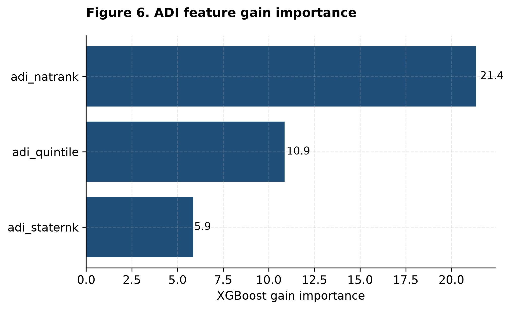
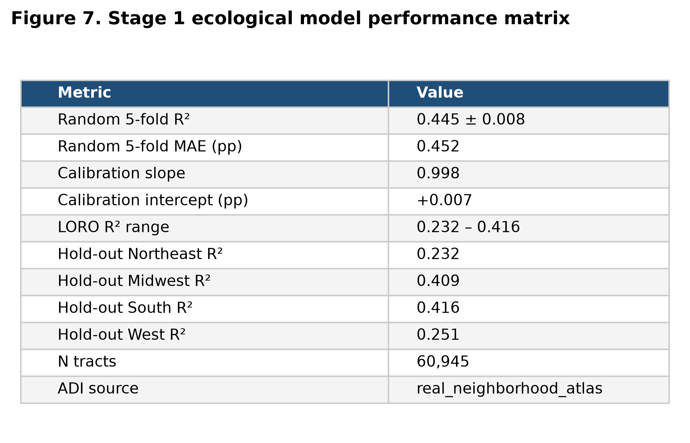
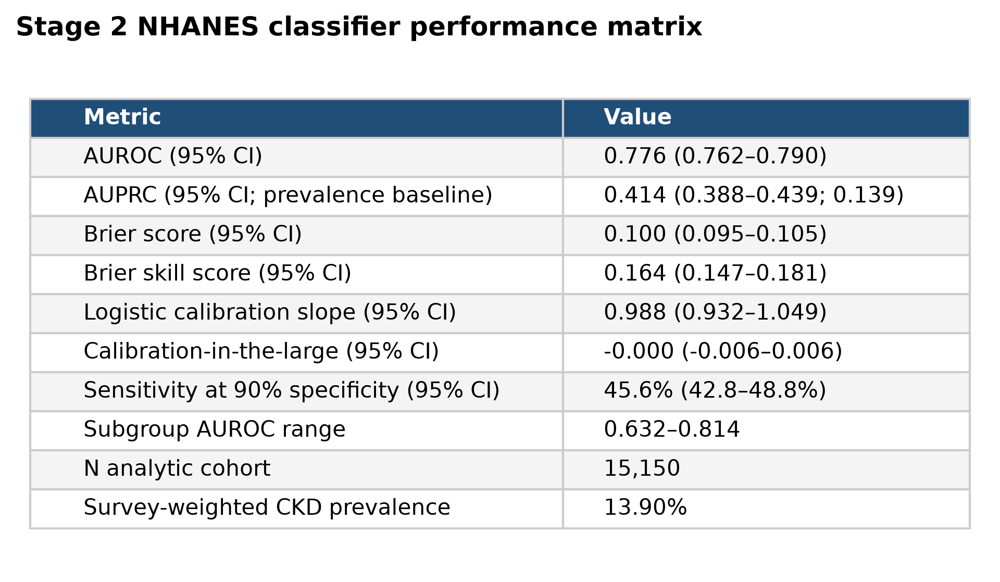

**Neighborhood Deprivation and Undetected Chronic Kidney Disease Burden: Open Small-Area Surveillance and Non-Laboratory Screening Triage Using CDC PLACES and NHANES**

Ajit Sahu^1^, Sanjoy Mukherjee^2^

^1^ DataSafeguard.ai, United States

^2^ Independent Researcher, United States

**Corresponding author:** Ajit Sahu, asahu@datasafeguard.ai

# Abstract

**Background:** Chronic kidney disease (CKD) affects approximately 14% of US adults, and up to 9 in 10 are unaware of it. The burden is concentrated in deprived neighborhoods, but agencies have few tools to decide where and in whom to offer testing, and the CDC PLACES tract-level CKD estimate was discontinued in 2024.

**Objective:** To determine (1) how much of the neighborhood-level variation in CKD prevalence can be explained by area-level social risk, measured with the Area Deprivation Index (ADI), and (2) how accurately and how equitably adults with laboratory-defined CKD can be identified using only information available without laboratory testing.

**Methods:** We conducted a cross-sectional secondary analysis of public data. Stage 1 related tract-mean ADI to CDC PLACES 2022 tract-level CKD prevalence in 60,945 US census tracts using gradient-boosted regression, evaluated with 5-fold and leave-one-Census-region-out cross-validation. Stage 2 used 15,150 adults from NHANES 2017–March 2020 and 2021–August 2023. The outcome was CKD defined by KDIGO 2024 criteria (race-free CKD-EPI 2021 eGFR <60 mL/min/1.73 m² or urine albumin-to-creatinine ratio ≥30 mg/g). Predictors required no laboratory testing: demographics, income-to-poverty ratio, body mass index, measured blood pressure, and self-reported conditions. We compared gradient boosting (XGBoost) with logistic regression, with survey-design–based 95% CIs.

**Results:** Area deprivation explained 44.5% of between-tract variation in CKD prevalence (cross-validated R²=0.445, SD 0.008; mean absolute error 0.45 percentage points), and predictions were well calibrated (slope 0.998). Mean tract prevalence rose from 2.45% in the least-deprived ADI quintile to 3.90% in the most-deprived, a 1.6-fold gradient. Performance was lower when the Northeast (R²=0.232) or West (R²=0.251) was held out. In NHANES, survey-weighted CKD prevalence was 13.9%, ranging from 10.6% at an income-to-poverty ratio ≥3.5 to 16.3% below 1.3. The non-laboratory classifier achieved an area under the receiver operating characteristic curve (AUROC) of 0.772 (95% CI 0.758–0.787). This did not differ from logistic regression (0.778; difference −0.006, 95% CI −0.013 to 0.002). Predictions were overconfident at the high end (logistic calibration slope 0.75, 95% CI 0.70–0.80). At 90% specificity, sensitivity was 44.9% (95% CI 41.7%–48.2%) and positive predictive value 42.2%. AUROC was 0.70–0.81 across race/ethnicity groups and 0.74–0.78 across income groups, but 0.64 (95% CI 0.61–0.68) in adults younger than 50 years.

**Conclusions:** Area deprivation reproduces the CKD deprivation gradient reported in prior studies and offers an open way to keep prioritizing neighborhoods now that tract-level estimates are discontinued, provided it is recalibrated by region before deployment. Information collected without laboratory tests identifies adults with CKD with moderate accuracy; a simple logistic model performs as well as machine learning, but needs local recalibration and is least useful in younger adults. Both tools support targeting confirmatory testing; neither replaces laboratory diagnosis.

**Keywords:** chronic kidney disease; public health surveillance; social determinants of health; area deprivation index; screening; NHANES; CDC PLACES; health equity; prediction model; calibration

# Introduction

Chronic kidney disease (CKD) affects more than 1 in 7 US adults, about 35.5 million people, and as many as 9 in 10 adults with CKD are unaware of their condition {{cdc2023}}. Undetected CKD progresses silently toward kidney failure and markedly raises cardiovascular risk. Kidney failure treated with dialysis costs Medicare roughly USD 89,000 per patient per year {{usrds2023}}. Detection is inexpensive: a serum creatinine test and a urine albumin-to-creatinine ratio. The public health problem is therefore less about diagnostic technology than about deciding *where* and *in whom* to offer testing when resources for outreach and screening are limited.

The burden of CKD is not evenly distributed. Socioeconomic disadvantage is consistently associated with higher CKD prevalence, faster progression, and worse outcomes, both at the individual level and at the neighborhood level {{vart2015}}{{crews2014}}{{nicholas2015}}. In this paper we use *social risk* in the sense proposed by Alderwick and Gottlieb {{alderwick2019}}: adverse social conditions, such as low income, low educational attainment, unemployment, and poor housing quality, that are associated with poor health. Social risk is distinct from *social needs*, which are the priorities identified by individuals themselves. Social risk can be measured for places, such as a neighborhood's deprivation, or for people, such as a household's income relative to the poverty line. Both are directly relevant to how health departments target CKD outreach.

Health departments have relied on the CDC PLACES program for small-area estimates of chronic disease to target such outreach. PLACES produced model-based estimates of CKD prevalence for every US census tract. That measure was discontinued in the 2024 PLACES release {{places_notes}}, so the most recent tract-level CKD estimates reflect 2020 survey data and will not be updated. Agencies that use these estimates to locate high-burden neighborhoods need a transparent replacement built from data that continue to be published. At the individual level, existing CKD screening questionnaires, such as SCORED {{bang2007}} and the Kshirsagar incident-CKD score {{kshirsagar2008}}, were developed on data from 1999–2002 and earlier. They predate the 2021 race-free eGFR equation and the current KDIGO definition of CKD, and they were not evaluated for performance across income or race/ethnicity groups. Machine-learning CKD models are numerous, but their reported performance depends heavily on kidney laboratory inputs such as eGFR and albuminuria, which are unavailable before testing occurs {{sanmarchi2023}}. Established kidney risk equations such as the Kidney Failure Risk Equation also require eGFR and albuminuria {{tangri2011}}.

This study addressed two public health questions. First, how much of the neighborhood-level variation in CKD prevalence is explained by area-level social risk, and is that relationship stable enough across US regions to support neighborhood prioritization once tract-level surveillance estimates are no longer produced? Second, how accurately can adults with laboratory-defined CKD be identified using only information available without a blood or urine test? Is that accuracy comparable across age, sex, race/ethnicity, and individual-level income groups, and does a more complex machine-learning model add anything over a transparent regression score? We answered both questions using only publicly available data and openly released code, so that health departments can reproduce, audit, and recalibrate the tools for their own populations.

# Methods

## Study Design and Data Sources

This was a cross-sectional secondary analysis of three publicly available data sources, organized in two stages. In Stage 1, census tracts were the unit of analysis. Area-level social risk was measured with the University of Wisconsin Neighborhood Atlas Area Deprivation Index (ADI) 2020 {{kind2018}}. The ADI is a composite of 17 American Community Survey indicators of income, education, employment, and housing quality, released for 242,335 census block groups as a national percentile rank (1–100) and a within-state decile (1–10). The outcome was the crude prevalence of CKD among adults aged 18 years or older from the CDC PLACES 2022 census tract release (dataset shc3-fzig) {{places2022}}. PLACES derives this prevalence from Behavioral Risk Factor Surveillance System (BRFSS) 2020 self-report using multilevel regression and poststratification {{zhang2014}}. The release covers 72,337 tracts, with prevalence ranging from 0.5% to 14.4% (mean 2.96%).

In Stage 2, individuals were the unit of analysis. We used the National Health and Nutrition Examination Survey (NHANES) 2017–March 2020 pre-pandemic combined release and the August 2021–August 2023 cycle {{nhanes}}. We included adults aged 18 years or older with serum creatinine or urine albumin and creatinine measured at the mobile examination center (MEC). We merged the demographic, body measures, standard biochemistry, urine albumin/creatinine, oscillometric blood pressure, blood pressure and cholesterol, diabetes, medical conditions, and income files. The analytic cohort comprised 15,150 adults. Following NCHS guidance for combining cycles, we divided the MEC examination weights (WTMECPRP for 2017–2020 and WTMEC2YR for 2021–2023) by 2.

## Stage 1: Area Deprivation and Tract-Level CKD Prevalence

Block-group ADI ranks were averaged within each census tract to give three tract-level features: mean national rank, mean state rank, and mean ADI quintile, with the quintile derived from the national rank. Tracts were linked to PLACES by tract FIPS code. Block-group ADI values suppressed by the Neighborhood Atlas (group quarters, low population, or questionable data; 6,449 of 242,335 block groups) were treated as missing. Of the 72,337 PLACES tracts, 60,945 (84.3%) linked to an ADI tract, and 24,450 of the 85,395 ADI tracts (28.6%) had no PLACES match. In 499 linked tracts, every block group was suppressed; these tracts were retained in the model, which handles missing values natively, but have no ADI quintile and are omitted from quintile summaries. Most unlinked tracts are likely attributable to the difference in boundary vintage between the two products: the ADI uses 2020 Census geography and the PLACES 2022 tract files use 2010 Census tracts.

We modelled tract CKD prevalence as a function of the three ADI features using gradient-boosted regression trees (XGBoost {{xgboost}}; 600 trees, maximum depth 5, learning rate 0.05, row and column subsampling 0.9). Hyperparameters were fixed in advance rather than tuned. To verify that results did not depend on this choice, we refit the model across 5 settings spanning 200–1000 trees and depths 3–7. We estimated performance with random 5-fold cross-validation and with leave-one-Census-region-out cross-validation. The latter trains on 3 of the 4 Census regions (Northeast, Midwest, South, West) and predicts the fourth, to test whether the deprivation–CKD relationship transfers between regions. We report R², mean absolute error (MAE), the Spearman rank correlation between predicted and observed prevalence, and calibration, summarized as the slope and intercept of observed on predicted prevalence across deciles of out-of-fold predictions. We also report mean predicted and observed prevalence by ADI quintile.

## Stage 2: Identifying Adults With CKD Without Laboratory Testing

The outcome was CKD as defined by KDIGO 2024 {{kdigo2024}}: estimated glomerular filtration rate (eGFR) below 60 mL/min/1.73 m², or urine albumin-to-creatinine ratio (UACR) of 30 mg/g or above. eGFR was calculated with the 2021 race-free CKD-EPI creatinine equation {{inker2021}}. UACR was calculated as urine albumin (mg/L) × 100 divided by urine creatinine (mg/dL). Because both measurements come from a single examination, the outcome identifies laboratory-defined CKD at one time point; the KDIGO criterion that abnormalities persist for at least 3 months cannot be applied. This single-measurement definition is the established convention for national CKD prevalence estimates from NHANES, including those of the CDC CKD Surveillance System {{cdc2023}}{{murphy2016}}{{coresh2007}}. It somewhat overestimates persistent CKD, mainly because albuminuria measured once can be transient {{coresh2007}}.

The predictors were limited to information obtainable without laboratory testing. These were age, sex, race/ethnicity (NHANES RIDRETH3, 6 categories), family income-to-poverty ratio (PIR), body mass index, and systolic and diastolic blood pressure, calculated as the mean of up to 3 oscillometric readings. Self-reported diagnoses of hypertension, diabetes, heart failure, and stroke were also included. Responses of "refused" or "don't know" were treated as missing. The primary model was an XGBoost classifier (500 trees, maximum depth 4, learning rate 0.05, subsampling 0.9), which handles missing values natively, trained with MEC weights as sample weights. Hyperparameters were again fixed in advance.

The comparator was an L2-penalized logistic regression on the identical predictors. It used median imputation and standardization fitted within each training fold, one-hot encoding of race/ethnicity, and balanced class weights. Comparing the two models answers whether a transparent regression score, which a health department could publish as a points table, performs as well as the machine-learning model. To show how much the clinical predictors add beyond basic demographics, we fitted the same logistic regression with 2 reduced predictor sets: age and sex only, and age, sex, race/ethnicity, PIR, and body mass index.

Both models were evaluated on out-of-fold predictions from the same stratified 5-fold cross-validation (random seed 42). All performance measures were survey-weighted. We assessed discrimination with the AUROC and the area under the precision–recall curve (AUPRC). Overall accuracy was summarized with the Brier score. Calibration was assessed with the logistic calibration slope and calibration-in-the-large, following Van Calster et al {{vancalster2019}}, and visualized by decile of predicted risk. We report clinical usefulness as sensitivity, specificity, and predictive values at prespecified specificity targets (95%, 90%, 80%, 70%, and 60%), and as net benefit from decision-curve analysis {{vickers2006}}.

Equity of performance was assessed with AUROC within age groups (<50, 50–64, ≥65 years), sex, the 6 race/ethnicity categories, and 3 categories of individual-level social risk. These categories were PIR below 1.3 (approximately the eligibility threshold for the Supplemental Nutrition Assistance Program), 1.3 to 3.49, and 3.5 or above. Because the CKD outcome is race-free but race/ethnicity is a predictor, we also refit the model without race/ethnicity to quantify how much the model depends on it.

All 95% CIs were design-based. We used the Rao–Wu rescaled bootstrap {{raowu1988}} with 1,000 replicates: within each NHANES masked variance stratum (SDMVSTRA), primary sampling units (SDMVPSU) were resampled with replacement, and MEC weights were rescaled accordingly. This accounts for the stratified, clustered NHANES design, which simple resampling of individuals ignores. Out-of-fold predictions were held fixed across replicates, so the intervals reflect sampling uncertainty in the evaluation sample. The difference in AUROC between XGBoost and logistic regression was assessed with the same paired replicates and, for comparison, with DeLong's test {{delong1988}}.

Missing predictor values were handled natively by XGBoost. As a sensitivity analysis, we used multiple imputation by chained equations (m=5, with posterior sampling) fitted within each training fold, and refit the model on each imputed data set. Because 4 predictors are self-reported diagnoses, we estimated how often a diagnosis is likely missing from self-report. Among adults reporting no hypertension diagnosis, we calculated the survey-weighted proportion whose measured blood pressure was 140/90 mm Hg or higher, overall and by PIR group.

## Reproducibility

All analysis code is available in the public project repository {{github}}. The pipeline runs from raw public downloads to every figure and table: src/fetch_nhanes.py and src/fetch_places.py download the source files, src/train_ecological_model.py fits Stage 1, src/train_nhanes_model.py fits Stage 2, src/stage2_supplementary.py produces the confidence intervals, comparator, imputation, operating-point, and race-free analyses, and src/generate_ecological_figures.py and src/generate_stage2_figures.py produce the figures and tables. Analyses used Python 3.11, XGBoost 3.2, scikit-learn 1.8, and pandas 3.0 with a fixed random seed of 42.

## Ethical Considerations

This study was a secondary analysis of publicly available, deidentified data, and the authors had no interaction with participants. NHANES data collection was approved by the NCHS Research Ethics Review Board (Protocol #2011-17 for data collected before October 26, 2017; Protocol #2018-01 for data collected from October 26, 2017 through March 2020; and Protocol #2021-05 for 2021–2023) {{nchs_erb}}. NHANES participants provided written informed consent under these protocols, and participants received remuneration from NCHS for the examination; no compensation was provided in this secondary analysis. CDC PLACES and the Neighborhood Atlas ADI are aggregate, area-level data containing no individual-level information. Because the analysis used only publicly released, deidentified data and the investigators could not identify any individual, it does not constitute human subjects research under the US Common Rule (45 CFR 46.102(e)(1)) {{cfr46}}. Institutional review board approval and additional informed consent were therefore not required, and none was sought. NHANES public-use files are deidentified by NCHS through its disclosure review process. We did not attempt to link NHANES records to any other data source or to geographic identifiers. The Neighborhood Atlas ADI file was obtained under its no-cost data use agreement and is not redistributed with this article.

# Results

## Stage 1: Area Deprivation Explains Much of the Neighborhood CKD Burden

Across 60,945 linked census tracts, the three ADI features explained 44.5% of between-tract variation in CKD prevalence (cross-validated R²=0.445, SD 0.008 across folds). The mean absolute error was 0.45 percentage points (Figure 1; Figure 7). Out-of-fold predictions were well calibrated, with a decile calibration slope of 0.998 and intercept of +0.007 percentage points (Figure 2). The Spearman rank correlation between predicted and observed tract prevalence was 0.67. This is consistent with R², which is on a squared scale (the square root of 0.445 is 0.67); rank correlation is the more directly relevant measure when the model is used to order tracts for prioritization. Performance varied by less than 0.01 in R² (0.440 to 0.445) across the 5 model-capacity settings (Figure 4). This indicates that the result reflects the deprivation signal rather than a particular model configuration.

Observed PLACES prevalence rose monotonically with deprivation, from a tract mean of 2.45% in the least-deprived ADI quintile through 2.60%, 2.83%, and 3.20% to 3.90% in the most-deprived quintile, a 1.6-fold difference. Mean predicted prevalence was within 0.002 percentage points of observed prevalence in every quintile (Figure 5). The model therefore did not attenuate the deprivation gradient at the quintile level, even though, like any regression model, it compresses the extremes of individual tracts (predicted values span roughly 2%–5%, against observed values of 0.5%–14.4%; Figure 1). ADI national rank carried the largest gain importance, followed by quintile and state rank (Figure 6). Because the quintile is derived from the national rank, the division of importance between these two features is not meaningful; together they carry most of the signal.

The relationship transferred unevenly between regions (Figure 3). A model trained on the other 3 regions explained 41.6% of variation in the South and 40.9% in the Midwest, but only 25.1% in the West and 23.2% in the Northeast. Calibration slopes in the held-out regions were 0.69 (Northeast), 0.81 (West), 0.90 (Midwest), and 1.14 (South). A slope below 1 means that the deprivation gradient in that region is flatter than the national model assumes. The model therefore overestimates prevalence in that region's most-deprived tracts and underestimates it in the least-deprived. A slope above 1, as in the South, means the gradient is steeper than the national model assumes.

{width="6.0in"}

*Figure 1. Out-of-fold predicted versus CDC PLACES–observed CKD prevalence for 60,945 census tracts. Each point is one tract; the dashed line indicates perfect agreement. Cross-validated R²=0.445.*

{width="6.0in"}

*Figure 2. Calibration of the Stage 1 model: mean out-of-fold predicted versus observed CKD prevalence by decile of predicted prevalence (slope 0.998, intercept +0.007 percentage points).*

{width="6.0in"}

*Figure 3. Leave-one-Census-region-out validation. Each panel shows R², MAE (percentage points), and calibration slope for the held-out region when the model is trained on the other 3 regions.*

{width="6.0in"}

*Figure 4. Cross-validated R² (mean and SD across 5 folds) across 5 XGBoost capacity settings.*

{width="6.0in"}

*Figure 5. Mean model-predicted and CDC PLACES–observed tract CKD prevalence by ADI quintile (1=least deprived, 5=most deprived).*

{width="6.0in"}

*Figure 6. XGBoost gain importance of the three tract-level ADI features.*

{width="6.0in"}

*Figure 7. Summary of Stage 1 performance: random 5-fold and leave-one-region-out cross-validation.*

## Stage 2: Identifying Adults With CKD Without Laboratory Testing

Of 15,150 adults (representing 248.6 million US adults), 2,706 met the CKD definition, a survey-weighted prevalence of 13.9% (Table 1). This matches CDC's published national estimate {{cdc2023}}. Adults with CKD were older (mean age 60.3 vs 45.6 years) and more often reported hypertension (60.0% vs 26.6%), diabetes (32.9% vs 8.2%), or heart failure (10.1% vs 1.6%). They also had a lower mean income-to-poverty ratio (2.72 vs 3.11). Prevalence followed an individual-level social risk gradient: 16.3% among adults with PIR below 1.3, 16.5% at PIR 1.3–3.49, and 10.6% at PIR 3.5 or above. Missing data were most common for PIR (13.5%) and blood pressure (7.3%) and were below 5% for all other predictors (Multimedia Appendix 1, Table S1).

**Table 1. Characteristics of the NHANES 2017–2023 analytic sample (n=15,150), survey-weighted, by CKD status.**

| Characteristic | Overall | No CKD | CKD |
|---|---|---|---|
| Participants, n (unweighted) | 15,150 | 12,444 | 2,706 |
| Weighted population, millions | 248.62 | 213.99 | 34.62 |
| Age, years, mean (SD) | 47.7 (17.9) | 45.6 (17.2) | 60.3 (17.5) |
| Female, % | 51.6 | 51.0 | 55.6 |
| Non-Hispanic White, % | 61.1 | 61.2 | 60.7 |
| Non-Hispanic Black, % | 11.2 | 10.5 | 15.1 |
| Hispanic, % | 16.6 | 17.1 | 12.9 |
| Income-to-poverty ratio, mean (SD) | 3.06 (1.64) | 3.11 (1.65) | 2.72 (1.58) |
| Body mass index, kg/m², mean (SD) | 29.6 (7.3) | 29.5 (7.3) | 30.7 (7.6) |
| Systolic blood pressure, mm Hg, mean (SD) | 121.2 (17.1) | 119.8 (15.7) | 129.6 (22.4) |
| Diastolic blood pressure, mm Hg, mean (SD) | 74.1 (10.9) | 74.0 (10.5) | 74.7 (13.5) |
| Self-reported hypertension, % | 31.2 | 26.6 | 60.0 |
| Self-reported diabetes, % | 11.6 | 8.2 | 32.9 |
| Self-reported heart failure, % | 2.8 | 1.6 | 10.1 |
| Self-reported stroke, % | 3.6 | 2.7 | 8.9 |

The XGBoost classifier discriminated adults with and without CKD with an AUROC of 0.772 (95% CI 0.758–0.787) (Figure 8; Table 2). The AUPRC was 0.402 (95% CI 0.374–0.433), against a prevalence baseline of 0.139 (Figure 9), and the Brier score was 0.102 (95% CI 0.096–0.109). The logistic regression comparator achieved an AUROC of 0.778 (95% CI 0.764–0.793). The difference between models was −0.006 (95% CI −0.013 to 0.002; design-based bootstrap P=.11; DeLong test P=.59). The machine-learning model therefore offered no discrimination advantage over the transparent regression model. Much of the discrimination came from demographics. Logistic regression with age and sex alone reached an AUROC of 0.728 (95% CI 0.717–0.741), and adding race/ethnicity, PIR, and body mass index raised it to 0.748 (0.736–0.762). Measured blood pressure and the self-reported conditions added a further 0.030 (95% CI 0.024–0.036), and the full model improved on age and sex alone by 0.050 (0.043–0.057).

Overall predicted risk matched observed prevalence (calibration-in-the-large +0.004, 95% CI −0.002 to 0.011). However, predictions were too extreme: the logistic calibration slope was 0.75 (95% CI 0.70–0.80). In the highest-risk decile the mean predicted probability was 0.56 against an observed prevalence of 0.46, and in the lowest deciles predicted risk was below observed (Figure 10). Mean predicted risk closely tracked observed prevalence within each income group (16.4% vs 16.3% for PIR <1.3; 10.0% vs 10.6% for PIR ≥3.5).

**Table 2. Performance of the Stage 2 non-laboratory classifier (out-of-fold, survey-weighted; 95% CIs from a design-based bootstrap with 1,000 replicates).**

| Measure | XGBoost, estimate (95% CI) | Logistic regression, estimate (95% CI) |
|---|---|---|
| AUROC | 0.772 (0.758–0.787) | 0.778 (0.764–0.793) |
| AUROC, range across 5 folds | 0.760–0.803 | — |
| AUPRC (prevalence baseline 0.139) | 0.402 (0.374–0.433) | — |
| Brier score | 0.102 (0.096–0.109) | — |
| Logistic calibration slope | 0.751 (0.703–0.803) | — |
| Calibration-in-the-large | +0.004 (−0.002 to 0.011) | — |
| Sensitivity at 90% specificity, % | 44.9 (41.7–48.2) | — |
| Difference in AUROC, XGBoost − logistic regression | −0.006 (−0.013 to 0.002) | |
| AUROC, logistic regression with age and sex only | — | 0.728 (0.717–0.741) |
| AUROC, logistic regression with age, sex, race/ethnicity, PIR, and body mass index | — | 0.748 (0.736–0.762) |

At a threshold chosen for 90% specificity (predicted risk ≥0.291), the classifier flagged 14.8% of adults. It identified 44.9% of adults with CKD, with a positive predictive value of 42.2% and a negative predictive value of 91.0% (Table 3). Among adults flagged for testing, 42% would therefore have CKD, about 3 times the population prevalence. Lowering the threshold traded specificity for sensitivity. At 70% specificity, for example, sensitivity was 72.1% and 35.9% of adults were flagged (Multimedia Appendix 1, Table S2). The decision curve showed higher net benefit for the model than for testing everyone or no one across risk thresholds of 0.05 to 0.40 (Figure 12). The margin over testing everyone was negligible at a threshold of 0.05.

**Table 3. Classification at the 90%-specificity threshold (predicted risk ≥0.291), survey-weighted to the US adult population (millions).**

| | Classified as not at risk | Classified as at risk |
|---|---|---|
| No CKD | 192.71 | 21.28 |
| CKD | 19.08 | 15.54 |

*Sensitivity 44.9%, specificity 90.1%, positive predictive value 42.2%, negative predictive value 91.0%.*

Discrimination varied more by age and sex than by race/ethnicity or income (Figure 11). AUROC was 0.64 (95% CI 0.61–0.68) in adults younger than 50 years, 0.71 (0.68–0.74) at 50–64 years, and 0.69 (0.67–0.72) at 65 years or older. All three are lower than the overall AUROC because age, the strongest single predictor, varies little within each band. AUROC was 0.81 (0.78–0.83) in men and 0.74 (0.71–0.76) in women. Across race/ethnicity groups AUROC ranged from 0.70 (0.65–0.77) among Mexican American adults to 0.81 (0.77–0.87) among adults of other or multiple races, with overlapping CIs. Across income groups it ranged from 0.74 (0.71–0.77) at PIR 3.5 or above to 0.78 (0.76–0.81) at PIR 1.3–3.49. Removing race/ethnicity as a predictor reduced overall AUROC by 0.006 (95% CI 0.002–0.010), to 0.766. The largest reductions were among non-Hispanic Asian (0.781 to 0.761) and non-Hispanic Black adults (0.770 to 0.757) (Multimedia Appendix 1, Table S3). Multiple imputation of missing predictors changed AUROC by +0.001 (mean 0.774 across 5 imputations).

{width="6.0in"}

*Figure 8. Receiver operating characteristic curve of the Stage 2 classifier (out-of-fold, survey-weighted). AUROC 0.772 (95% CI 0.758–0.787).*

{width="6.0in"}

*Figure 9. Precision–recall curve of the Stage 2 classifier. The dashed line marks the survey-weighted CKD prevalence (13.9%).*

{width="6.0in"}

*Figure 10. Calibration of the Stage 2 classifier by decile of predicted risk. Logistic calibration slope 0.75 (95% CI 0.70–0.80); calibration-in-the-large +0.004.*

{width="6.0in"}

*Figure 11. Survey-weighted AUROC by age group, sex, race/ethnicity, and income-to-poverty ratio (PIR), with 95% design-based bootstrap CIs. The dashed line marks the overall AUROC.*

{width="6.0in"}

*Figure 12. Decision-curve analysis of the Stage 2 classifier compared with testing all adults and testing none.*

{width="6.0in"}

*Figure 13. Summary of Stage 2 performance with 95% design-based CIs.*

# Discussion

## Principal Findings

Using only public data, we found that area-level social risk, measured by the ADI, explains about 44% of the variation in CKD prevalence between US census tracts. Prevalence is 1.6 times higher in the most- than in the least-deprived quintile of tracts. The relationship is strongest in the South and Midwest and weaker in the Northeast and West. At the individual level, information available without a laboratory test, such as age, blood pressure, and self-reported conditions, identified adults with laboratory-defined CKD with moderate accuracy (AUROC 0.77). This accuracy was similar across race/ethnicity and income groups but lower in younger adults and in women. A transparent logistic regression model performed as well as gradient boosting.

## Comparison With Prior Work

Our findings are consistent with prior evidence, which supports their validity, but they answer a different question. The 1.6-fold deprivation gradient in tract CKD prevalence lies within the 1.5- to 2.0-fold socioeconomic gradients reported in earlier individual-level and meta-analytic studies {{vart2015}}{{crews2014}}{{nicholas2015}}, although at the lower end of that range. Model shrinkage does not explain the position, because predicted and observed quintile means coincide. More plausible contributors are the smoothing inherent in PLACES small-area estimation, which pulls tract estimates toward values expected from their demographic composition {{zhang2014}}; the averaging of individual risk within tracts that contain residents of differing socioeconomic position; and under-ascertainment of CKD in self-reported survey data, which may itself vary with deprivation. The individual-level income gradient in our NHANES sample (16.3% vs 10.6%) points the same way. What is new is not the existence of the gradient but its use for surveillance: we quantify how much of the national small-area CKD map can be recovered from a deprivation index that continues to be published, and how well that relationship transfers between regions. This matters now because CDC PLACES discontinued its tract-level CKD measure {{places_notes}}. Our Stage 1 model is an ecological, interpretable stand-in for prioritizing neighborhoods rather than a replacement for multilevel small-area estimation {{zhang2014}}{{wakefield2020}}. The 55% of variation it does not explain, and its weaker performance in the Northeast and West, show where deprivation is an insufficient guide and where local data are needed.

For individual screening, the most comparable tools are questionnaire-based scores. SCORED reported an AUROC of 0.88 in its NHANES 1999–2002 development data and 0.71 on external validation {{bang2007}}. However, it targeted only reduced eGFR and used a race-based eGFR equation, and two of its inputs, proteinuria and anemia, require laboratory results. Our classifier predicts the broader KDIGO 2024 definition, which includes albuminuria with preserved eGFR and is harder to detect from risk factors alone. It uses the race-free 2021 equation, contemporary NHANES data, and no laboratory inputs, and its accuracy (0.77) falls between SCORED's development and validation estimates. That logistic regression matched XGBoost agrees with a systematic review that found no average benefit of machine learning over logistic regression for clinical prediction models {{christodoulou2019}}. In practice, this means a health department can deploy a published, auditable points-style score without losing accuracy. A further contribution beyond earlier scores is the reporting of calibration and performance across income and race/ethnicity groups, with survey-design–based uncertainty.

## Public Health Implications

The two stages correspond to two decisions that health departments make. Where to send outreach, mobile screening, or community health workers is a neighborhood-level decision, and Stage 1 ranks tracts by expected CKD burden using an index agencies already use for other programs. Who to offer a creatinine and urine albumin test to, once someone is reached, is an individual-level decision, and Stage 2 provides a triage score usable at intake, in pharmacies, or at community events. At a threshold that flags about 1 in 7 adults, 42% of those flagged would have CKD, roughly 3 times the base rate. However, more than half of all adults with CKD would not be flagged. The score is therefore suited to prioritizing testing when testing capacity is limited, not to ruling CKD out. Where capacity allows, a lower threshold or universal testing of adults with hypertension or diabetes, as KDIGO recommends {{kdigo2024}}, captures more cases. In both stages social risk informs targeting directly: Stage 1 allocates attention to places by deprivation, and Stage 2 includes household income as a predictor and performs comparably across income groups.

Equity requires care. The CKD outcome uses the race-free eGFR equation, consistent with the NKF-ASN Task Force recommendation {{delgado2022}}, but race/ethnicity is a predictor in Stage 2. Removing it lowered accuracy only slightly (AUROC 0.772 vs 0.766), so agencies that prefer not to use race in allocation can use the race-free version at little cost. Predictions were overconfident at high risk, as the calibration slope of 0.75 shows. Any deployment should therefore recalibrate the score to local data before predicted probabilities are communicated, even if the ranking of individuals is retained. Lower accuracy in adults younger than 50 years, in whom CKD is less common and risk factors are less informative, means the score should not be the only route to testing for younger adults with diabetes or hypertension.

## Limitations

Several limitations should be considered when interpreting these results. The Stage 1 outcome is itself a model-based estimate: PLACES derives tract prevalence from self-reported BRFSS diagnoses using demographic and area covariates. Self-reported CKD greatly underestimates true prevalence, given that most people with CKD are unaware of it, and the PLACES estimation model may share socioeconomic inputs with the ADI. Stage 1 therefore shows how well deprivation recovers the federal small-area estimate, not true tract prevalence. Validation against laboratory-based data, such as health system or state registry records, is needed before relying on it for absolute burden.

The analysis is also ecological. Tract-level associations cannot be applied to individuals, which is why individual triage is addressed separately in Stage 2. About 16% of PLACES tracts and 29% of ADI tracts could not be linked, most likely because of the change in Census tract boundaries between 2010 and 2020. Using the Census relationship file to reallocate these tracts {{census_crosswalk}} would test whether the excluded tracts differ systematically. We also evaluated only one deprivation index; others, such as the Social Vulnerability Index, may perform differently.

For Stage 2, NHANES is cross-sectional and measures creatinine and albuminuria once, so the outcome includes some transient abnormalities and does not capture progression. The model detects prevalent CKD and does not predict future kidney failure, which tools such as the Kidney Failure Risk Equation address after diagnosis {{tangri2011}}. The 2017–2020 data were collected before the COVID-19 pandemic interrupted fieldwork and are combined with 2021–2023 data using CDC-recommended weights. Temporal changes between these periods were not modelled. Performance was estimated by internal cross-validation in a nationally representative sample. External validation in the populations where a health department would use the tool, such as uninsured adults attending community screening events, has not been done. Four predictors are self-reported diagnoses (hypertension, diabetes, heart failure, and stroke) and are subject to recall and reporting bias. Being aware of a diagnosis also depends on prior contact with health care, so the score may be less accurate among people with poor access to care, the group screening most needs to reach. In our data, 9.3% (95% CI 8.4%–10.3%) of adults who reported no hypertension diagnosis had measured blood pressure of 140/90 mm Hg or higher. This proportion was similar across income groups (9.7%, 10.0%, and 8.8% for PIR <1.3, 1.3–3.49, and ≥3.5). Measured blood pressure is itself a predictor and partly offsets missed diagnoses. We could not assess unreported diabetes, heart failure, or stroke, or differences by insurance status, and in settings with worse access than the national average the comparability across groups that we observed may not hold. Finally, the Stage 1 analysis requires the registration-controlled Neighborhood Atlas file. Reproducing it therefore requires each user to obtain the file directly.

## Future Directions

The next steps follow from these limitations. External validation of the Stage 2 score in community screening programs and safety-net clinics, with laboratory confirmation, would show whether its accuracy and calibration hold in the settings where it would be used. Region-specific recalibration of the Stage 1 model, particularly in the Northeast and West, and comparison with other deprivation indices would show whether local models recover more of the neighborhood variation. Linking neighborhood prioritization to individual triage in a prospective outreach program would allow the yield of confirmed CKD per test, and its cost, to be measured directly.

# Conclusions

Neighborhood deprivation accounts for a substantial share of the geographic variation in CKD burden across the United States and reproduces the deprivation gradient found in earlier studies. It therefore offers health departments an open, transparent basis for prioritizing neighborhoods now that federal tract-level CKD estimates have been discontinued. Because the deprivation–CKD relationship differs between regions, the model should be recalibrated to regional or state data before it is used to allocate resources, particularly in the Northeast and West. Information collected without laboratory tests can identify adults likely to have CKD with moderate accuracy that is similar across racial, ethnic, and income groups. A simple, publishable regression score performs as well as machine learning. These tools are aids for deciding where and in whom to offer confirmatory eGFR and albuminuria testing. They require local recalibration before use and do not substitute for laboratory diagnosis.

# Acknowledgments

The authors thank the National Center for Health Statistics and the NHANES participants, the CDC PLACES program, and the University of Wisconsin Neighborhood Atlas team for making these data publicly available.

# Funding

The authors declared no financial support was received for this work.

# Data Availability

All data analyzed in this study are publicly available. NHANES public-use files are available from the National Center for Health Statistics at https://wwwn.cdc.gov/nchs/nhanes/. The CDC PLACES 2022 census tract release (dataset shc3-fzig) is available at https://data.cdc.gov/500-Cities-Places/PLACES-Census-Tract-Data-GIS-Friendly-Format-2022-/shc3-fzig. The 2020 Area Deprivation Index is available from the University of Wisconsin Neighborhood Atlas at https://www.neighborhoodatlas.medicine.wisc.edu/ after free registration and acceptance of its data use agreement. Under that agreement we cannot redistribute the file, and researchers must download it directly. All analysis code, the scripts that download the public data sets, and all derived results tables are available in the project repository (participant-level out-of-fold predictions are regenerated by the scripts) at https://github.com/sanjoyp158-sri/sdoh_ckd_pred. An archived snapshot with a persistent identifier will be deposited in Zenodo on acceptance.

# Use of Generative AI

The authors used Claude (Anthropic) to help write and debug analysis code, to draft and edit manuscript text, and to check reported values against analysis outputs. The authors reviewed, edited, and verified all AI-assisted content, re-ran all analyses, and take full responsibility for the content of this article.

# Authors' Contributions

Conceptualization: AS. Methodology: AS. Software: AS, SM. Formal analysis: AS. Data curation: SM. Validation: SM. Visualization: AS. Writing – original draft: AS. Writing – review & editing: AS, SM.

# Conflicts of Interest

AS is employed by DataSafeguard.ai. DataSafeguard.ai did not fund this work and has no commercial product based on it. SM declares no conflicts of interest.

# Abbreviations

ADI: Area Deprivation Index; AUPRC: area under the precision–recall curve; AUROC: area under the receiver operating characteristic curve; BRFSS: Behavioral Risk Factor Surveillance System; CKD: chronic kidney disease; eGFR: estimated glomerular filtration rate; KDIGO: Kidney Disease: Improving Global Outcomes; MAE: mean absolute error; MEC: mobile examination center; NCHS: National Center for Health Statistics; NHANES: National Health and Nutrition Examination Survey; PIR: income-to-poverty ratio; UACR: urine albumin-to-creatinine ratio.

# Multimedia Appendix 1

**Table S1. Missing data by predictor and multiple-imputation sensitivity analysis (n=15,150).**

| Predictor | Missing, n | Missing, % |
|---|---|---|
| Age | 0 | 0.0 |
| Sex | 0 | 0.0 |
| Race/ethnicity | 0 | 0.0 |
| Income-to-poverty ratio | 2,050 | 13.5 |
| Body mass index | 250 | 1.7 |
| Systolic blood pressure | 1,105 | 7.3 |
| Diastolic blood pressure | 1,105 | 7.3 |
| Self-reported hypertension | 16 | 0.1 |
| Self-reported diabetes | 479 | 3.2 |
| Self-reported heart failure | 712 | 4.7 |
| Self-reported stroke | 708 | 4.7 |

*Multiple imputation by chained equations (m=5, posterior sampling, fitted within training folds) gave AUROCs of 0.772–0.776 (mean 0.774), compared with 0.772 using native missing-value handling.*

**Table S2. Operating points of the Stage 2 classifier at prespecified specificity targets (survey-weighted).**

| Target specificity | Threshold | Sensitivity | Specificity | PPV | NPV | Adults flagged, % |
|---|---|---|---|---|---|---|
| 95% | 0.422 | 0.287 | 0.950 | 0.482 | 0.892 | 8.3 |
| 90% | 0.291 | 0.449 | 0.901 | 0.422 | 0.910 | 14.8 |
| 80% | 0.155 | 0.629 | 0.801 | 0.339 | 0.930 | 25.8 |
| 70% | 0.098 | 0.721 | 0.700 | 0.280 | 0.939 | 35.9 |
| 60% | 0.071 | 0.787 | 0.602 | 0.242 | 0.946 | 45.2 |

**Table S3. Survey-weighted AUROC with and without race/ethnicity as a predictor, by race/ethnicity group.**

| Group | With race/ethnicity | Without race/ethnicity |
|---|---|---|
| All adults | 0.772 | 0.766 |
| Mexican American | 0.700 | 0.696 |
| Other Hispanic | 0.741 | 0.733 |
| Non-Hispanic White | 0.775 | 0.775 |
| Non-Hispanic Black | 0.770 | 0.757 |
| Non-Hispanic Asian | 0.781 | 0.761 |
| Other or multiple races | 0.815 | 0.807 |

*Difference overall 0.006 (95% design-based CI 0.002–0.010).*

# References

{{REFERENCES}}
